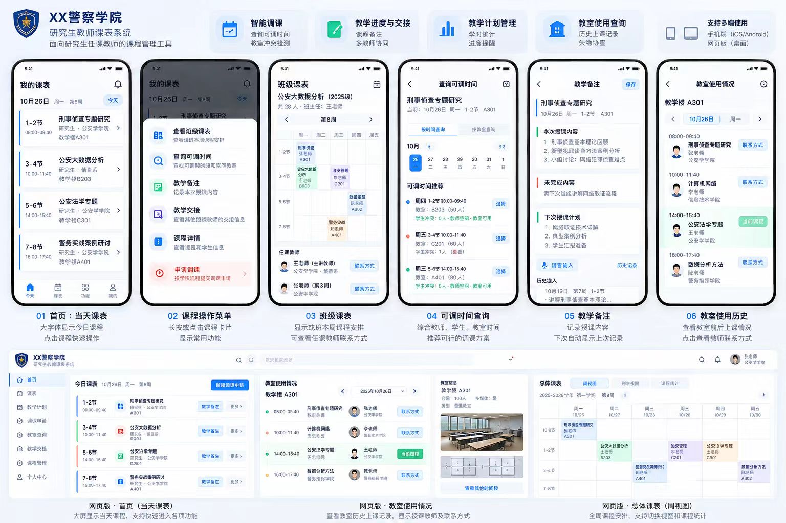

# 教师课程表 App

面向研究生任课教师的移动教学辅助工具：今天上什么课、上一节讲到哪里、下次由谁接课、能调到哪个时段，都围绕同一份正式课表衔接。

## 当前：Android 演示版

Flutter 四核心（课表与调课、备注与交接、计划与学时、教室与失物）与 Django 后端已可本地运行，当前含 37 门课、13 位教师、30 间教室、878 名虚构学生和 1440 个课次。校区为团河校区、木犀校区，楼宇为历警楼、慧警楼、高警察楼，房号为三位数。李、张、王三位老师周一到周五均有课程，整周视图可直接演示。

- 一键启动与账号说明：[docs/local-demo.md](docs/local-demo.md)（`pwsh scripts/start-demo.ps1`）
- 实际验收与截图：[docs/local-demo-acceptance.md](docs/local-demo-acceptance.md)
- 手机联网环境、安装与基础功能补齐：[docs/phone-demo.md](docs/phone-demo.md)。用户指定的香港服务器通过 IP 提供现有后端，手机不依赖电脑局域网。
- [GitHub Release 安装包下载（1.1.0）](https://github.com/xuanfengdabiti/teacher-schedule-app/releases/download/v1.1.0/teacher-schedule-v1.1.0-android.apk)（[发布说明](https://github.com/xuanfengdabiti/teacher-schedule-app/releases/tag/v1.1.0)、[服务器备用下载](http://38.76.172.48:18001/teacher-schedule.apk)），已预设演示服务器地址；本轮 117 项 Flutter 测试通过。
- APK：`mobile/build/app/outputs/flutter-apk/app-release.apk`（约 46 MB，Android ARM64 / x64）
- 仅用于演示，没有远程推送、商店发布或 iOS 实机验收；学校接口仍未对接。
- 完整方案档案：[实现方案](docs/implementation-plan.md)、[领域规则](docs/domain-design.md)、[交付清单](docs/delivery-backlog.md)。

当前演示支持登录、首次获取课表的导入画面、今日课表、按日列表/整周总览切换、课次详情、三段备注保存草稿与共享、进度交接收发确认、教学计划编辑、学时完成登记、调课候选与申请、按时段和容量查询空教室、教室记录、失物询问回复结案和站内消息。登录页可快捷填入李老师、张老师、王老师，三人有同课轮讲安排，见[演示团队](docs/demo-team.md)。“我的”支持编辑资料与联系方式、修改密码和按账号保存字号。后端同时保留注册、邮箱验证、密码找回、教务导入与审批接口；教师网页版暂不开发。

新增[AI 课前备课助手](docs/ai-lesson-preparation.md)：从本人课次详情进入“AI备课”，结合上次备注、教学计划和本节授课时长，调用真实模型生成授课提纲、虚构课堂案例、讨论问题和课前准备；教师可修改并保存，再次打开继续使用。模型服务通过 Django 后端接入，普通课表无需模型服务也可使用。

演示业务数据也已补充：37 门课都有教学计划，历史课次有完成记录和专题学时；教师甲、李、张、王都有交接收发、失物收发、调课记录和站内消息。以 2026-10-28 为演示日期，今天及未来课程保留待上课状态，方便现场登记；补充脚本重复执行不会累计增加数据，见[活动演示数据](docs/demo-activity-data.md)。

## 四个核心方向

1. **课表与智能调课**：今日/周/班级课表，检查授课教师、实际选课学生、教室冲突，申请并记录正式调整。
2. **教学备注与多教师交接**：已讲、未完成、下次计划，下次授课回顾与交接确认。
3. **教学计划与课时进度**：章节计划、完成确认、已完成与剩余学时、进度偏差提醒。
4. **空教室、教室记录与失物消息**：按时段/容量查空闲教室，从“教室与失物”统一入口查看使用记录、教师联系方式，发起失物询问并回复、结案。

完整版本同时包括注册登录、邮箱验证、密码找回、教师身份关联、数据导入、消息与推送、离线查课和个人设置。

## 文档入口

| 文档 | 用途 |
| --- | --- |
| [详细实现方案](docs/implementation-plan.md) | 产品范围、页面、技术架构、接口、离线与通知、部署、排期和验收 |
| [领域规则与数据设计](docs/domain-design.md) | 实体、关键字段、调课/交接/学时规则、业务验收场景 |
| [开源调研与选型](docs/open-source-research.md) | 实际开源候选、许可证、复用范围与适配验证 |
| [导入约定和模板](docs/import-spec.md) | 学校数据字段、稳定编号、导入顺序和示例文件 |
| [开发任务清单](docs/delivery-backlog.md) | 可直接拆成 Issue 的任务、依赖和完成标准 |
| [开发规范](CONTRIBUTING.md) | 代码组织、命名、依赖、API、测试、提交与评审要求 |
| [界面措辞约定](docs/ui-wording.md) | 老师可见的标题、按钮、消息与提示用词，区分草稿、共享和交接 |
| [首次登录导入演示](docs/demo-login-import.md) | 按教师身份读取示例课表的过渡画面、完成记录与真实接口边界 |
| [个人资料、密码与字号](docs/demo-personal-settings.md) | 编辑联系方式、修改密码和按账号保存字号的操作说明 |
| [手机联网演示](docs/phone-demo.md) | 香港服务器 IP、Android 安装、注册找回、头像与本地上课提醒及实际验收 |
| [AI 课前备课助手](docs/ai-lesson-preparation.md) | 真实模型接入、备课生成与保存、接口及本机配置 |
| [开发代理指引](AGENTS.md) | 后续自动化开发必须遵循的仓库约束 |
| [第三方复用记录](THIRD_PARTY.md) | 候选与实际引入的区分、归属与许可证记录要求 |
| [原始开发概要](docs/requirements/original-brief.md) | 未修改归档，便于核对最初需求 |

原始概要提到的 `ui-preview.png` 和 `index.html` 未随本目录提供；实际图片为上方 `ui.jpg`。本仓库没有可运行网页预览。

## 当前实现与原方案

当前使用 Flutter + Riverpod + go_router + Dio；登录信息使用 flutter_secure_storage，本地小草稿与设置使用 SharedPreferences。Django 5.2 + Django REST framework + PostgreSQL 提供本地服务；账号、管理后台和 XLSX 读取复用成熟组件。依赖版本已锁定，见 THIRD_PARTY.md。

详细方案中的 Drift、完整离线队列、远程推送、商店发布与 9–12 周排期属于原完整产品规划，不是本地演示版的交付条件。当前验收以实际安装并操作 Android App 为准。

## 数据与许可证

[模板目录](templates/import/README.md)中的姓名、邮箱、学号和课表全部为虚构示例。真实学校导出文件、账号参数和签名材料不放进公开仓库。

本项目当前尚未声明源代码开源许可证；公开仓库不等于已授予 MIT 等再分发许可。后续实际引入第三方源码时保留其原有许可与归属，详见第三方复用记录。
