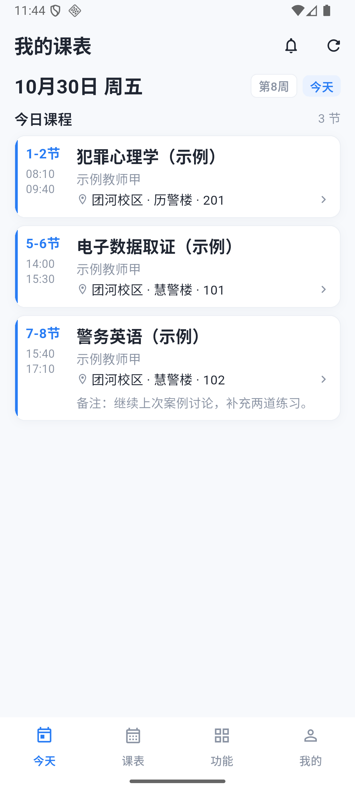

# 北京服务器迁移

用户于 2026-10-30 授权将香港演示环境整体迁移到北京服务器，通过 IP 访问。移动端地址迁移由沿用的 DeepSeek Harness 会话实现，Codex 负责审查、部署和验收。继续运行现有单体后端与 PostgreSQL，不增加学校接口或新的业务依赖。本页以实际核对记录为准。

## 地址与安装包

| 项目 | 迁移前 | 迁移后 |
| --- | --- | --- |
| API | `http://38.76.172.48:18000/api/v1/` | `http://101.201.48.132/api/v1/` |
| 安装包备用下载 | `http://38.76.172.48:18001/teacher-schedule.apk` | `http://101.201.48.132/teacher-schedule.apk` |
| 工程目录 | `/srv/teacher-schedule` | `/srv/teacher-schedule` |
| Compose 项目 | `teacher-schedule-phone` | `teacher-schedule-phone` |

新包为 Android **1.2.0（6）**，沿用蓝白界面、放大后的字体、单击课程操作菜单和整周双指缩放。首次安装默认连接北京；覆盖安装时，将保存的旧香港地址切换到北京，并复制该地址下的字号与首次导入记录。手动填写的其他地址保持原样，本地备注草稿与登录材料保留。

安装：[GitHub Release 安装包](https://github.com/xuanfengdabiti/teacher-schedule-app/releases/download/v1.2.0-preview.4/teacher-schedule-v1.2.0-preview.4-android.apk) · [发布页](https://github.com/xuanfengdabiti/teacher-schedule-app/releases/tag/v1.2.0-preview.4) · [北京备用下载](http://101.201.48.132/teacher-schedule.apk)。可直接覆盖安装，保留原账号和本机记录。

APK 为 **46,225,831 字节**，SHA-256：`6EA250649E02C17536CEC59A86FCA48B53FD15E16C41DDF0D8AF303F725D6A2F`。Android 7.0 起，支持 ARM64 / x86_64。原版 1.1.0 与此前预览版的 Release 资产保留。

## 迁移范围与顺序

迁移香港现有数据库中的账号、正式课表、备注、进度交接、教学计划、学时、调课、教室、失物、消息和 AI 备课草稿，以及头像等媒体文件。保留数据库凭据、Django 签名配置和 Yue / `deepseek-v4.1-flash` 配置，避免重新建库造数据和无故清除登录状态。

1. 安装北京运行环境并建立公网 TCP 80 入口；API 在服务器内监听 `127.0.0.1:18000`，由 Nginx 转发。
2. 比较香港实际运行镜像与当前源码：**253 个后端文件内容一致**，比较时仅统一换行符。
3. 环境准备完成后停止香港 API 写入，导出数据库和媒体；香港数据库卷与原文件保留。
4. 恢复到北京，逐表比较行数与内容摘要、全部序列状态、全部媒体文件摘要；通过后才启动北京 API。
5. 从公网检查原登录材料、四个演示账号与主要功能读取、真实 AI 生成，并在模拟器覆盖安装新包检查地址迁移。
6. 香港原 API 端口转发到北京，原下载地址转到北京新包；原应用容器停止，避免两边各自写库。

备份保存在两台服务器各自的 `/srv/teacher-schedule-transfer/`，包含 `database.dump`、`media.tar.gz` 和内容核对清单。这些文件及部署私有配置不放入公开仓库。旧电脑到香港时未迁移的本机历史数据不属于这次香港到北京的数据范围。

## 复用与构建

北京系统为 Ubuntu 26.04.1 LTS，使用 Docker、Compose 和 Nginx。沿用现有 `infra/deploy/compose.yaml`、`backend/Dockerfile`、`uv.lock` 与 Flutter 锁定依赖，没有新增客户端或后端依赖。

Docker Hub 直连不可用，构建时使用私有 Dockerfile 调整下载源：DaoCloud 获取原 Python 摘要和 PostgreSQL 16.15，Debian 软件包通过阿里云镜像下载；Python 制品通过清华镜像下载，版本与校验摘要不变，安装后恢复原始锁文件。PostgreSQL 镜像清单与香港一致，摘要为 `sha256:1beaa3084eee2676f20a9cd9928f0bf2c5bf674f8e49f81017912183d377c61c`。API 镜像在北京根据相同后端源码与锁定依赖重新构建。

```powershell
cd mobile
flutter build apk --release --build-name=1.2.0 --build-number=6 --dart-define=API_BASE_URL=http://101.201.48.132/api/v1/
```

本机实际采用[手机联网演示](phone-demo.md)中的 Gradle 构建方式，关闭 Kotlin 跨盘增量缓存，并用同一地址与版本配置。构建前后全部 Dart 源文件摘要一致。

## 实际验收

- Flutter 全量 **140 项通过**，静态检查通过，**115 个 Dart 文件**格式检查无变化。
- 地址迁移新增 6 项检查，覆盖旧地址、首次导入与字号记录、既有北京设置优先、其他地址保持、重复运行和草稿/登录材料保留。
- **23:41 暂停香港 API，23:42 恢复北京数据，23:43 完成旧地址转发。** 迁移前后的 **62 张表、8,492 条记录、19 个序列状态与 12 个媒体文件**逐项一致；没有重新运行种子初始化。
- 北京 API 与数据库容器均为 healthy，公网健康检查返回 `status=ok, database=ok`。旧香港 API 地址经 Nginx 转发到北京，香港原应用与数据库容器均已停止，备份及原卷保留。
- 香港签发的访问与刷新材料在北京均通过；教师甲、李、张、王四个账号的登录、本人周课表、开课、备注、教学计划、AI 草稿、交接收发、失物收发、调课记录、站内消息、教室使用与空教室查询读取通过，调课候选实际查询通过。
- 北京真实 AI 生成 **7.4 秒、四段共 511 字**，模型为 `deepseek-v4.1-flash`；生成前后原备课草稿一致。
- 常规读取约 **0.03–0.17 秒**，首次同步 **1.3–3.1 秒**，七天调课候选 **2.9 秒**。这是本机到公网的一轮检查，不是并发压力测试。
- Android 36 模拟器实际覆盖安装 **1.2.0（6）**，无需重新登录即进入教师甲原有课表；保存地址已自动改为北京，**4 条**原地址下的字号/导入记录复制正确，旧记录仍保留，已有首次导入记录未重复展示导入。
- 首页课程、正确授课时间与短备注正常显示，单击课程打开操作菜单；北京 Nginx 实际记录到该安装包的 Dart 请求。尚未连接实体手机，本记录不等于实体手机实测。
- 北京安装包 HTTP 200、长度与完整文件摘要一致，Range 下载为 206 且文件头正确；香港原下载地址返回 302 到北京新包。


