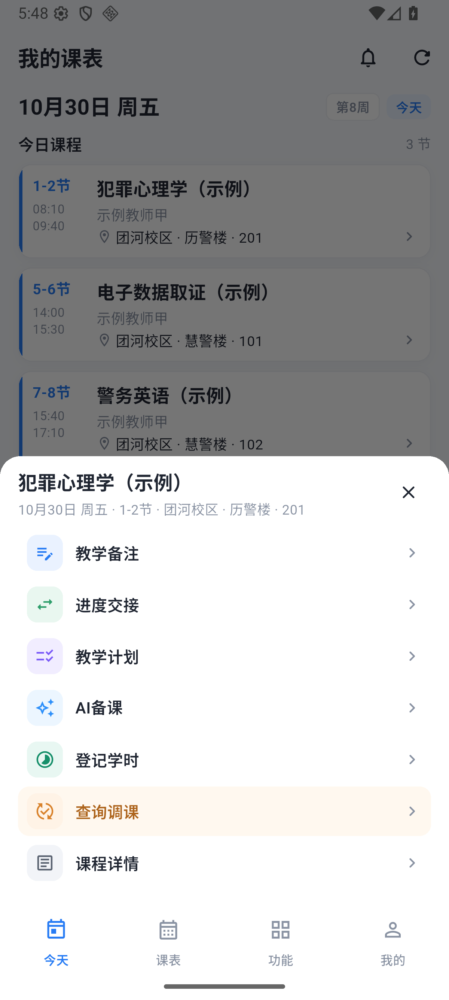
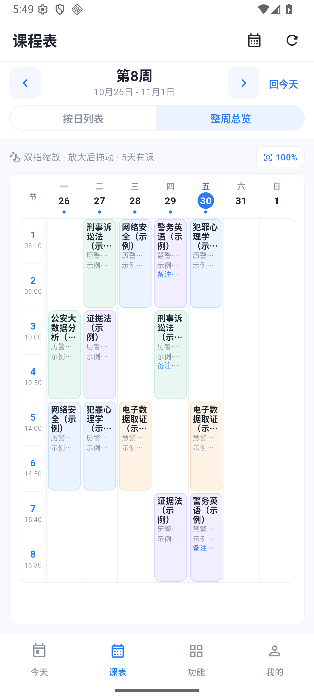
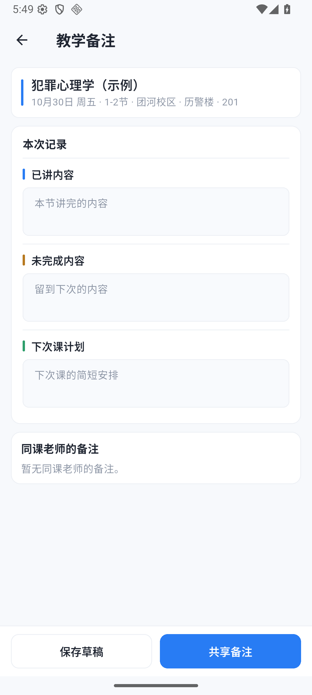

# 蓝白界面预览

2026-10-30 用户要求按最初参考图重新制作界面，并给整周课表加入双指缩放。保留已经验收发布的 [1.1.0 原版](https://github.com/xuanfengdabiti/teacher-schedule-app/releases/tag/v1.1.0)；新界面在 `codex/blue-ui-preview` 分支开发，不替换旧版 Release 资产，不修改服务器业务和演示数据。

参考图：[用户提供的初始界面](screenshots/blue-ui-reference.png)。图中的文字和时段用于视觉参考，实际授课时间、两校区地址、四核心功能和当前中文名称继续沿用已有业务。

安装：[蓝白预览版 APK](https://github.com/xuanfengdabiti/teacher-schedule-app/releases/download/v1.2.0-preview.4/teacher-schedule-v1.2.0-preview.4-android.apk) · [预览发布页](https://github.com/xuanfengdabiti/teacher-schedule-app/releases/tag/v1.2.0-preview.4)。当前 preview.4 为 Android 1.2.0（6），直连北京服务器，覆盖安装自动更新旧香港地址并保留登录、字号和首次导入记录；[完整迁移与核对](beijing-migration.md)。下文首轮与 preview.2 / preview.3 记录保留作历史对照，原版仍为正式 Latest。

## 视觉与操作

- 蓝色 `#287CF4`、极浅灰背景 `#F7F9FC`、白色内容卡和浅色分割线；成功、需确认等状态保留各自含义。
- 课程卡使用蓝色细竖线、窄节次栏和紧凑的课程/教师/地点信息。简短备注直接显示，标签为“备注”。
- 缩小原来大面积的装饰背景与留白，保留清晰的字体层次、较大字号适配和完整地点信息。
- 首页和按日列表的蓝白课程卡单击打开操作菜单，菜单里的“课程详情”继续进入原详情页；长按也保留同一菜单。整周总览格子单击直接查看课次。备注、计划、进度交接、学时、调课与 AI 备课继续调用既有业务。
- 教学备注、调课候选和教室使用页统一为简洁分区或列表，不添加参考图中尚未实现的语音等按钮。
- 整周课表支持双指放大、缩小和放大后拖动；周切换与底部导航不参与缩放，只保留百分比复位，不放加减按钮或手势说明文字。

## 复用与边界

继续复用 Flutter Material、既有主题和路由；缩放采用 Flutter SDK 的 `InteractiveViewer` / `TransformationController`，不新增日历、手势或设计系统依赖。锁定 SDK 许可证为 BSD-3-Clause，沿用 Flutter 的许可声明。

此次只改移动端界面，不改调课状态、稳定课次 ID、实际学时统计、备注草稿/共享/冲突处理、交接确认和教室/联系方式规则。原版源码可从 `v1.1.0` 标签恢复，原安装包仍可从其 Release 下载。

## 验收记录

2026-10-30：由 DeepSeek Harness 的 Yue / Flash 会话分组实现，Codex 审查与运行。复查确认备注草稿、保存与共享、冲突恢复，以及调课查询/提交、教室日期/联系方式/失物入口的业务方法保留。审查发现的整周备注被缩成图标、Riverpod 版本访问方式和缺少日期帮助函数导入等问题已交回 DS 修复。

- Flutter 全量 **127 项通过**；全项目 `flutter analyze --no-pub` 无问题；111 个 Dart 文件格式检查无变化。
- Android ARM64 / x86_64 release 构建成功：版本 **1.2.0（3）**，最低 Android 7.0，APK **46,160,295 字节**。构建后再次比对全部 Dart 源码摘要，未发生变动。
- Android 36 模拟器实际覆盖安装成功，沿用原账号读取公网演示课程，首页短备注直接显示；课程长按菜单与教学备注打开正常，未为截图修改或保存教学数据。
- 在已安装的 release 包上注入两个实际触点，整周课表由 **100% 放大到 233%**；单指拖动后课程位置发生变化，顶部/底部导航保持固定。点击放大后的“刑事诉讼法”课程，详情仍为原来的 **10月29日、3–4节**；返回后点击复位恢复 **100%**。
- 调课候选页已实际显示 316 个可用时段及独立冲突统计，未提交申请；教室记录入口与失物询问入口保留。当前检查来自模拟器，未宣称已做实体手机验收。

APK SHA-256：`162916271CAAD3703F6F5A3F46A34682742AA1AFCD591914D4AF4C6A7D40B467`。

复用现有锁定环境构建此预览版：

```powershell
cd mobile
flutter build apk --release --build-name=1.2.0 --build-number=3 --dart-define=API_BASE_URL=http://38.76.172.48:18000/api/v1/
```

本机实际采用[手机联网演示](phone-demo.md)记录的 Gradle 方式禁用 Kotlin 跨盘增量缓存，版本由本地构建配置指定为 1.2.0 / 3；原版 APK 和服务器下载文件不覆盖。

## 实际运行截图

2026-10-30 交互调整（preview.3）：按用户要求去掉“双指缩放／放大后拖动／几天有课”说明整行，不加入加减按钮。首页和按日列表单击卡片打开现有操作菜单，菜单内仍有课程详情。整周仍使用 SDK 双指手势，普通父组件传入新的课程列表不再强制复位，换周仍回到完整视图。

此次全量 **134 项测试通过**、静态检查通过、113 个 Dart 文件格式检查无变化。Android **1.2.0（5）** 构建并在可见 Android 36 模拟器覆盖安装；首页与按日卡片均已实际单击打开菜单。两个实际触点从课程格子上捏合，百分比由 **100% 到 144%**，没有误开详情；反向捏合回到 **100%**，再次放大后拖动，课块位置变化且比例保持。说明文字和加减按钮均不在页面上。此时未连接实体手机，不能将模拟器记录当作手机实测。

preview.3 APK **46,160,299 字节**，SHA-256：`6F0136C3F403CBFB9105DAD547633BE31862034F33A0F244CD272315D6C65D17`，构建前后 Dart 源码摘要一致。[单击课程后的菜单](screenshots/ui-tap-menu.png) · [无提示的整周课表](screenshots/ui-pinch-clean.png) · [双指放大后](screenshots/ui-pinch-zoom.png)。下面保留先前版本截图及验收记录作对照。

2026-10-30 字号调整：用户反馈字体偏小后，统一将默认阅读字号提高 **15%**；课程名约 18.4、教师/教室约 14.4、备注约 13.8，蓝白样式保留。继续复用 Flutter `MediaQuery` / `TextScaler`，仅增加薄的组合缩放器，保留系统非线性缩放以及“跟随系统／大／更大”偏好，不写入或覆盖账号偏好。日签改为自适应高度，避免大字又被固定高度压小。

字号调整版全量 **130 项测试通过**、静态检查通过，113 个 Dart 文件格式检查无变化；Android **1.2.0（4）** 构建并在可见模拟器覆盖安装，首页三节课、时间与短备注正常显示。包体 **46,160,295 字节**，SHA-256：`3EE1A3261DDAFFD55C97B14E03782F5F2F10E2EA5BD524B89069D8311DBE59A7`。构建前后 Dart 源码摘要一致。下表保留首轮截图作对照，[查看字体加大后的首页](screenshots/ui-blue-font-home.png)；原版与 preview.1 安装包均保留。

| 首页 | 课程长按菜单 |
| --- | --- |
|  |  |

| 整周总览 | 教学备注 |
| --- | --- |
|  |  |

[放大到 233%](screenshots/ui-blue-week-zoom.png) · [课程详情](screenshots/ui-blue-detail.png) · [查询调课](screenshots/ui-blue-reschedule.png) · [教室记录](screenshots/ui-blue-classroom.png) · [常用功能](screenshots/ui-blue-features.png) · [原版首页](screenshots/ui-before-home.png)
