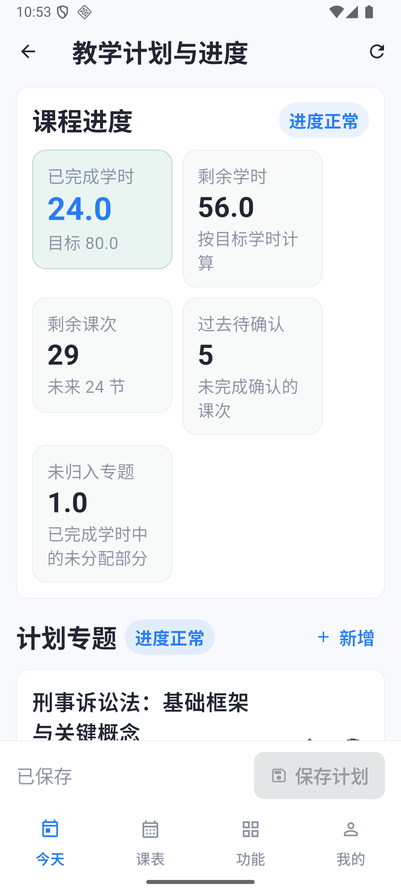

# 录制日临时课表（2026-10-31）

`scripts/seed_demo_recording_day.py` 只用于录屏当天，把 **2026-10-31（周六）** 临时排成有课的一天，并补少量备注与学时。它不属于默认演示种子，`scripts/start-demo.ps1` 不会执行它。

- 范围：`DEMO-SCHOOL` / `2026-autumn`，教师工号 `0001 / 0011 / 0012 / 0013`。
- 主录制账号：教师甲 `t0001@example.invalid`（工号 0001）。
- 目标日期默认 `2026-10-31`，来源日期默认 `2026-10-27`，均可用参数覆盖。

## 做法

1. 取来源日期当天四人的**全部**非取消实际课次（北京数据为 9 节：甲 3、李 4、张 1、王 1），按 `start_at`、`start_period`、`id` 稳定排序。
2. 为每节课建立稳定编码 `REC-YYYYMMDD-开课代码-起始节` 的 `ScheduleRule`，只覆盖目标教学周和目标星期，复用来源的开课、教室、节次、计划学时与实际授课教师。目标日若已有非本脚本的课次占用同一开课、教师或教室节次，则跳过该来源课。
3. 调用现有 `generate_sessions_for_term` 生成目标日课次。原课次的主键、状态、学时、备注都不移动、不复制、不覆盖；不创建校历例外，不影响其他日期。
4. 目标日占用检查排除本脚本 `REC-` 前缀的既有课次，因此复跑会重新选中同一份来源 recipe，再由稳定 `rule_code` 与既有生成键跳过，不会继续新增。

## 补充的演示内容

- 教师甲今天每门课：在最近一节更早的同开课、本人实际任课课次上补一句“下次计划”，供今日卡片直接显示备注；已有内容跳过。
- 今天第一门课本身：补三段短备注（已讲 / 未完成 / 下次计划）并发布共享，按课程名适配，不加演示前缀。
- 教学计划：只给确实没有计划的新演示开课补 4 个简短专题，计划总学时等于开课目标学时；已有计划完整保留。
- 历史学时：某门新演示开课仍为 0 学时时，只补一条已结束历史课次的完成记录，使进度非 0。
- 今日第一门已结束的本人课次：登记完成并分配 2.0 学时到一个现有专题，供页面展示“已完成”；正在上或未来的课次保持未完成，留给现场操作。
- 不写 AI 备课结果；交接收发、调课、失物等沿用已有数据，不重复铺量。

## 执行

脚本自动配置 Django。北京服务器（Compose 项目 `teacher-schedule-phone`）：

```sh
cd /srv/teacher-schedule
docker compose -p teacher-schedule-phone --env-file infra/deploy/.env -f infra/deploy/compose.yaml \
  cp scripts/seed_demo_recording_day.py api:/tmp/seed_demo_recording_day.py
docker compose -p teacher-schedule-phone --env-file infra/deploy/.env -f infra/deploy/compose.yaml \
  exec -T api python /tmp/seed_demo_recording_day.py --date 2026-10-31
```

本地演示容器（`teacher-schedule-demo-api-1`）可直接 `docker cp` 后 `docker exec` 执行同一命令。本地工程也可在 `backend` 目录运行：

```powershell
uv run python ../scripts/seed_demo_recording_day.py --date 2026-10-31 --source-date 2026-10-27
```

## 幂等与数据保留

- 规则按稳定 `rule_code` 去重；目标课次已存在时不再生成。
- 备注只在没有任何内容时写入；完成记录只在课次未完成且已结束时登记。
- 计划只在开课没有计划时创建。
- 第二次执行规则、课次、备注、计划、完成记录的新增均为 0，用户已编辑的内容不变。
- 输出规则/课次/计划/学时/备注的新增与跳过计数，今天四位老师的课次数，以及教师甲各课程的计划与已完成学时。

## 2026-10-31 实际验收

本轮由 DeepSeek Harness 实现，Codex 审查、在北京执行并检查 App。审查发现复跑时可能继续挑选其他课程的问题，已交回同一 Harness 会话修正后执行。

- 第一次新增 **9 条一次性规则、9 个课次、4 条备注、1 条完课记录（2.0 学时）**；已有的 9 门教学计划及历史学时均保留，没有重跑全库种子。
- 第二次规则、课次、计划、备注和完课新增均为 **0**，两次执行后的全部 **62 张表与序列状态**一致。
- 核对原有 36 类业务模型快照，原 **1,440 个课次**及已有备注、计划、完成记录保留。快照中的两条消息已读变化发生在脚本执行前，未回退这些正常操作。
- 四账号真实接口读取通过，今日课次数分别为教师甲 **3**、李 **4**、张 **1**、王 **1**；没有重装 APK。
- Android 36 模拟器实际首页显示 **10月31日 周六**、3 门课、正确时段、简短备注和首课“已完成”；计划页显示 **24.0 已完成 / 56.0 剩余 / 80.0 目标**、4 个既有专题。模拟器时区设为 `Asia/Shanghai`，日期保持当天。
- 脚本 Ruff 格式检查、静态检查和 Python 编译检查通过。未修改 Flutter、接口或数据库结构，未重复运行未修改的全量客户端测试。

教师甲录制时可直接使用：

| 课程 | 今天时段 | 本次课状态 | 课程累计学时 |
| --- | --- | --- | --- |
| 刑事诉讼法 | 08:10–09:40，1–2节 | 已完成 2.0 学时，有三段共享短备注 | 24.0 / 80.0 |
| 证据法 | 10:00–11:30，3–4节 | 未完成，卡片显示上次备注 | 22.0 / 80.0 |
| 犯罪心理学 | 14:00–15:30，5–6节 | 未完成，卡片显示上次备注 | 22.0 / 80.0 |

建议从教师甲首页进入，依次展示课程备注、教学计划与进度、学时登记、进度交接，再展示整周课表、空教室与失物。已有交接收发与失物记录继续使用；AI 备课仍通过真实接口生成。

| 今日课程 | 教学进度 |
| --- | --- |
|  |  |
