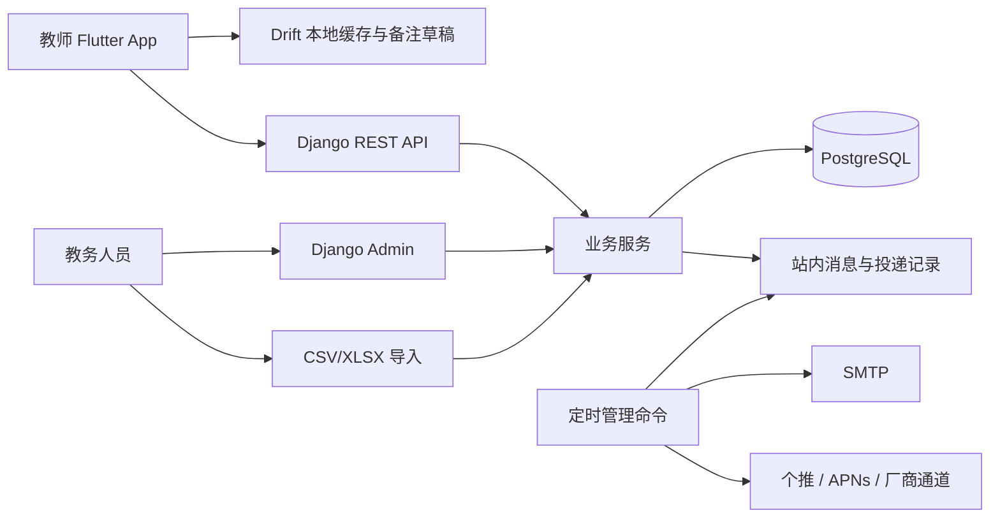

# 教师课程表 App 详细实现方案

> 版本：v1.0 完整产品设计基线｜编写日期：2026-10-26。当前已有可运行的本地 Android 演示版，实际交付范围见[本地演示验收](local-demo-acceptance.md)；本文中的完整上线计划不代表全部已实现，也不阻塞本地演示。
>
> 输入：[原始开发概要](requirements/original-brief.md)、[UI 参考图](../ui.jpg)。本文将原概要落实为完整移动 App；教师网页版暂缓。以下默认选择可直接用于开工，学校数据、审批与账号参数在接入时配置。

## 1. 产品目标与交付边界

面向研究生任课教师，打开 App 即看到今天在哪里、什么时候、给哪个教学班上课；课前能回顾上一课进度，课后能记备注、交接与更新学时，需要调课时能基于真实选课关系找到候选时间，需要联系前后任课教师时能从教室记录进入。

### 1.1 首个完整版本必须具备

| 模块 | v1 必须交付的结果 |
| --- | --- |
| 账号 | 注册、邮箱验证、教师身份关联、登录、保持登录、退出、找回/修改密码、修改资料、账号停用/注销入口 |
| 课表 | 今日/周视图、教学周切换、班级课表、课程详情、节假日与临时调整、空课与数据异常提示 |
| 调课 | 教师/实际选课学生/教室冲突检查、候选排序、申请、撤回、教务登记审批结果、正式生效及变更记录 |
| 教学备注与交接 | 已讲/未完成/下次计划、最近教学记录、课程共享记录、交接给指定教师、确认与未确认状态 |
| 教学计划与进度 | 总学时、计划章节、课次分配、授课完成确认、已完成/剩余学时、进度偏差提示 |
| 教室与协查 | 某教室某日排课及前后课程、教师自愿公开联系方式、协查请求与回复、结案 |
| 基础体验 | 消息中心、上课本地提醒、正式变更/交接远程推送、断网查已缓存课表、离线备注草稿、个人设置 |
| 教务维护 | 复用 Django Admin 维护校历/节次/课程、批量导入、异常处理、教师身份确认、审批结果登记 |
| 交付 | Android 安装包、iOS 测试包与发布工程、可部署服务、数据库迁移、示例数据、导入模板、使用/部署说明 |

“完整”指上述业务闭环可使用，开发过程分阶段交付。只做静态界面、把消息/登录按钮做成占位、用随机数据演示调课，都不算 v1 完成。

### 1.2 本期不做

- 教师网页版、桌面客户端、学生端、小程序、鸿蒙原生端。
- 自动替学校审批、自动抓取教务账号密码、全校自动排课。
- 即时聊天系统、通用工作流引擎、AI 教学总结、复杂报表平台。
- 实时考勤、人员定位、失物归属判断。教室页展示排定课程，不推断实际到场。

后台 Admin 是框架现成的教务维护工具，不另做一套网页产品。若“本期不做网页”也包含不使用任何浏览器管理入口，后续可替换为管理命令；本方案默认允许复用 Admin，以降低开发量。

### 1.3 默认条件与外部依赖

| 项目 | 开工默认值 | 需要接入时提供 |
| --- | --- | --- |
| 服务范围 | 单学校、单套服务；数据预留 school_id | 学校名称、学期和节次表 |
| 移动端 | Android 优先真机联调，iOS 同代码持续构建 | Android 签名、Apple 开发者账号及 Mac 构建环境 |
| 登录 | 邮箱+密码，工号用于关联教师资料 | 教师名册、SMTP 发件账号 |
| 数据接入 | 教务人员导入 CSV/XLSX | 学校导出的真实字段样本和选课名单 |
| 审批 | 教务在 Admin 登记学校已作出的审批结果 | 实际审批流程/编号；有 API 后再自动对接 |
| 推送 | 个推官方 Flutter 插件+服务端 REST API | 推送账号、Android 厂商参数、APNs 配置 |
| 部署 | 国内或校内可访问 Linux 主机+PostgreSQL | 主机、域名、HTTPS 证书、可访问网络 |

未提供上述参数时，用明确标注的虚构数据和开发邮件/推送日志推进开发；试点验收必须接入真实邮件、推送和授权课表数据。数据缺失不允许包装为“零冲突”。

## 2. 开源优先策略与技术定案

完整调研见[开源调研](open-source-research.md)。截至本次核查，已找到学生课表、通用日历和认证组件，尚未查到可直接覆盖四个教师核心流程的完整项目。这是本次检索结论，不代表不存在其他项目。

执行顺序固定为：检索现有能力 → 核查许可证与维护情况 → 做小范围适配验证 → 选库 → 只补业务差异。每个新依赖须在调研表留下链接、用途和替代成本。

| 层次 | 默认方案 | 复用内容 | 需要自己实现 |
| --- | --- | --- | --- |
| App | Flutter stable + Dart | 原生控件、跨 Android/iOS 工程、无障碍支持 | 教师业务页面与图中视觉样式 |
| 状态/路由/请求 | Riverpod、go_router、Dio | 状态管理、路由、网络请求 | 功能状态与业务导航 |
| 课表组件 | calendar_view 先做适配验证 | 周视图、事件布局、日期交互 | 节次刻度、冲突标识、教学周与课程卡片 |
| 本地数据 | Drift/SQLite | 查询、迁移、事务 | 缓存表、备注草稿与提交队列 |
| 后端 | Django 5.2 LTS + DRF | ORM、迁移、Admin、API 处理 | 四个领域服务和学校数据适配 |
| 账号 | dj-rest-auth + django-allauth + SimpleJWT | 注册、验证、密码流程、JWT 生命周期 | 教师名册关联、App 页面与邮件链接回跳 |
| 数据库 | PostgreSQL | 关系、索引、事务 | 数据模型、冲突查询与业务约束 |
| 导入 | Python csv、openpyxl | CSV/XLSX 读取 | 字段映射、预览、差异合并 |
| API 合同 | drf-spectacular + Dart JSON 生成工具 | OpenAPI 输出、DTO 序列化 | 合同字段、示例与客户端映射 |
| 提醒 | flutter_local_notifications；个推官方插件 | 本地提醒、远程投递 | 提醒规则、消息收件箱、点击跳转 |

不同时引入两套状态管理、两个 ORM、两套认证系统。账号使用 dj-rest-auth 路径，本期不再并用 allauth headless 的另一套登录接口。Django 的 LTS 支持信息以[官方发布页](https://www.djangoproject.com/download/)为准；开工安装兼容补丁版并锁定，不把本文写作时的小版本当成长期约束。

calendar_view 验证限 1 个工作日：覆盖节次、同时间两课、周末、跨午休、长课卡片、200% 字号。若节次布局不适合，只自写薄的课表布局控件，继续使用 Flutter/Riverpod/路由/缓存等已有能力。不要为复用日历库重做原生层或维护大规模 fork。

### 2.1 架构



采用单仓库、模块化单体，一个 App、一个 API 服务、一个数据库。第一版使用数据库消息表和定时管理命令处理提醒/推送重试，不引入 Redis/Celery/Kafka。只有实测任务量或处理时间需要时再增加队列。

## 3. 信息架构与页面规格

图片中的六个移动页面是基础流程，底部保留“今天 / 课表 / 功能 / 我的”。铃铛进入消息中心，功能页集中放教学计划、调课记录、教室查询和协查。

| 页面 | 内容与操作 | 状态要求 |
| --- | --- | --- |
| 启动/登录 | 学校标识、邮箱、密码、注册、忘记密码 | 登录态恢复；过期则刷新，失败返回登录 |
| 注册/验证 | 姓名、邮箱、密码、工号；邮箱确认 | 未验证、待身份确认、可用、停用分别说明 |
| 今天 | 日期/教学周、课程卡片、时间地点、待交接提示 | 今天无课；未导入；缓存数据及更新时间 |
| 周课表 | 上/下周、教学周选择、回今天、本人/教学班切换 | 周末、假期、调课后的新课卡片 |
| 课程快捷菜单 | 班级课表、调课查询、备注、交接、课程详情、申请记录 | 点击与长按均可进入，不只依赖长按 |
| 课程详情 | 教学班、任课教师、实际选课人数、教室、课时、最近记录 | 同名课程通过教学班与学期区分 |
| 调课查询 | 原课次、日期范围、教室条件、结果分组、提交申请 | 可推荐/有冲突/待核验，逐条解释原因 |
| 教学备注 | 已讲、未完成、下次计划、历史记录 | 草稿/保存中/已同步/待处理冲突 |
| 教学交接 | 指定接收人、内容、关联记录、查看/确认 | 待确认、已确认、已撤回；打开不算确认 |
| 教学计划 | 总学时、完成/剩余、章节列表、课次分配 | 未建计划、偏慢、超出计划学时 |
| 教室历史 | 建筑/教室、日期、排课时间线、联系、发起协查 | 空闲、临时占用、数据缺口有明确区别 |
| 联系教师 | 姓名、院系、自愿可见的电话/微信 | 一键拨号、复制；未公开则发协查请求 |
| 协查详情 | 物品描述、日期区间、回复列表、结案 | 待回复/有回复/已结案，无需即时聊天 |
| 消息中心 | 调课结果、课表更新、交接、协查回复、计划提醒 | 未读/已读、点击进入业务对象 |
| 我的 | 资料、联系方式可见范围、提醒、字号、学期、帮助、账号 | 保存结果、版本号、退出、注销入口 |

### 3.1 视觉和交互

- 遵循原图浅蓝/浅绿、柔和卡片、大字号方向；默认课程名 18sp 左右、正文 16sp、辅助信息 14sp，最终以真机排版确定。
- 关键按钮点击区域至少 48 逻辑像素；支持系统字号至 200%，长课名可换行，课表格中可截断但详情显示完整。
- 颜色之外同时提供文字/图标，例如“调课后”“待确认”“已取消”。
- 首页优先时间、课程、教室；教师姓名与班级作为第二层信息。用户从首页两次点击内能打开备注。
- 时间默认北京时间，24 小时制；日期必须附星期，周视图默认周一开始，能显示周六/周日。
- 页面空状态提供对应操作：重新同步、切换学期、联系教务、创建计划。请求失败保留已显示内容和草稿。
- 图片中的麦克风入口为后续增强；v1 使用文字输入和手机系统语音键盘，不单独集成语音识别服务。

## 4. 四个核心领域如何落地

完整实体、约束和边界场景见[领域规则与数据设计](domain-design.md)。本节明确 App 行为和实现顺序。

### 4.1 课表、教学周与调课

1. 校历定义学期首周周一、教学周数、每天节次、日期例外。单双周按教学周判断，不能按自然周数判断。
2. 从重复排课规则生成具体课次 ClassSession。规则用于生成，具体课次是备注、交接、进度和调课的关联对象。
3. 国庆等假期使用显式“停课/补星期几课程/特殊排课”例外，不依赖系统公共假期接口自动改课。
4. 班级课表按教学班聚合；学生冲突检查取当前 CourseOffering 在候选日生效的实际选课集合，与重叠课程的有效选课集合求交，覆盖跨班选修，不混入该教学班其他课程的选课学生。
5. 一次调课默认对应一个具体课次，保持课次 ID；调时间/教室不重建备注、不增加一次教学完成量。批量调课留到后续。

#### 候选生成与解释

- 输入：源课次 ID、日期范围（默认未来 14 天，可改，最多一个学期）、允许的节次段、教室范围、是否允许周末；v1 保持原 planned_hours、连续节次数和当前 SessionTeacher 集合，目标起止时间取目标日节次表，不固定墙钟持续分钟数。不做换教师、拆课或交换课，非标准时段由教务登记。
- 展开候选日期和合法连续节次；先排除非教学日、过去时间、跨禁止午休区间、教室停用和超出容量/设备条件的组合。已有跨午休长课可展示，不代表自动调课可以跨该禁用区间。
- 检查必须出席教师集合、实际选课学生集合、教室占用，以及可导入的教师/学生不可用时段；时间重叠使用左闭右开区间，上一课 09:40 结束、下一课 09:40 开始不冲突。
- 需保留课间/跨楼移动缓冲时，由学校配置分钟数，默认 0；配置后同时进入筛选和最终确认，避免两处算法不同。
- 返回冲突类别、涉及课程、学生冲突人数、选课数据时间、校历/课表版本。普通教师界面以人数为主，不必展示全校学生名单。
- 候选枚举固定为 available / conflict / unverified：所有必要数据完整且无硬冲突才可推荐；缺选课名单/全校占用等为待核验，可提交为标记 `needs_verification` 的申请，但不能普通批准；有已知硬冲突时归为 conflict 并同时说明数据缺口，只能保存草稿，不能提交。
- 排序采用明确规则：无冲突且数据完整优先 → 同教室 → 离原日期更近 → 原上课时间段相近 → 日期时间/教室编号稳定排序。v1 不需要大模型或全局排课求解器。

#### 申请与生效

`draft → submitted → approved / rejected / withdrawn`。申请只作为意向，不占用候选教室；页面说明“待学校批准”。

教务确认时，统一调用 reschedule service：先锁 SchoolSyncState，再锁学期 Term 行，再锁 RescheduleRequest 行 → 重新读取目标时段与实际选课名单 → 再次检查 → 锁 ClassSession 并更新其时间/教室/version 和学期 schedule_version → 保存前后快照和审批依据 → 写入同步日志、站内消息及待投递记录 → 提交事务。导入和教务手改课也经过相同写入口，所有服务采用同一锁顺序；单校试点规模用简单串行写入即可。

若两个申请同时竞争一个时段，先确认者成功，后确认者保持待处理并给出新冲突。若学校批准的是有已知冲突或数据缺口的特殊安排，不能静默强行通过：走 Admin 的“登记学校强制安排”，必填审批编号/说明、标记安排风险、同样保留历史并通知。该操作不归普通教师。

不开发自建审批引擎。学校有纸面/现有系统审批时，教务登记结果即可完成首版；后续对接学校 API 后仍复用相同确认服务。

### 4.2 教学备注与多教师交接

- 每课次每位授课教师可有一份备注，含已讲内容、未完成内容、下次计划；draft 默认仅作者可见，显式发布 published 版本后才对同一 CourseOffering 的任课教师共享。draft_body 与 published_body 分开保存，再编辑草稿不覆盖已发布快照；不同开课的教师不能因同属一个班就共享。
- 打开一个课次时，展示同一 CourseOffering 中授课时间早于它、状态 completed 且有 published 备注的最近课次记录，包含该课次各教师已发布内容；不能串到同名其他班，也不展示当前/更晚/未完成课次作为“上次”。
- “保存备注”与“确认授课完成”是两个动作；录入内容不会自动增加学时。
- 交接对象是同一 CourseOffering 的指定任课教师，可关联备注版本；接收人点击“确认已接收”产生确认时间，打开推送/查看记录只记录已读。
- 交接发出后用内容快照。修改原备注不会悄悄改变已确认交接，新增补充交接即可。v1 每条交接一个接收人，需要多人时生成多条。
- 离线支持备注草稿；发送交接、确认接收需要在线成功。版本冲突保留本地文本并展示服务器版本，由教师选择合并后保存。

### 4.3 教学计划与课时进度

- 每个 CourseOffering（学期+课程+教学班的一次开课）创建一份计划；同班不同课程各自维护。章节/专题包含标题、计划学时、预期完成课次或日期，可关联多个具体课次。
- planned_hours/actual_hours 采用 Decimal（建议 1 位小数），不要用浮点数；学校配置每学时分钟数，仅用于解释，不按墙上经过时间自动完成。
- 课程结束后任课教师确认完成课次，并填写/确认该课次实际学时和涉及章节；可更正，须留下调整原因。
- 已完成学时 = 有效已完成课次 actual_hours 之和；取消课不计；一课多教师不重复计入课程总学时。教师个人工作量拆分属于后续统计。
- 剩余学时 = max(课程目标学时 - 已完成学时, 0)，超出时另显示超出量；剩余课次按所有未完成且未取消的排定课次计，另显示“过去待确认课次”和未来课次数，不因时间已过漏计，也不用除法猜测。
- 章节实际完成量来自课次到章节的分配记录。同一课次分配给章节的学时合计不能超过该课次 actual_hours，允许有未分配部分并提示补充。
- 进度提醒：截至今天应完成的章节计划学时与实际分配学时比较；落后达到可配置阈值（默认 2 学时）每天至多汇总一次，补齐后关闭提醒。

### 4.4 教室历史、联系与失物协查

- 以教室实体 ID 查询某个本地日期的正式排课和人工登记占用，显示课程、时间、教学班、任课教师。只展示当前有效排定记录；变更历史另设入口。
- “前后课程”是所选时间范围附近的排定记录，不代表实际人员足迹；停课、调出和数据缺失须在列表中说明。
- 教师在个人设置中主动填写电话/微信，可见范围为“不公开 / 同课程教师 / 校内教师”，默认不公开。服务端按查看人返回允许显示的字段。
- 联系方式按钮支持拨号和复制微信；不承诺自动添加微信。未公开时可发站内协查。
- 轻量协查：选择教室、日期/时间段、物品描述 → 系统列出相关排课教师供勾选 → 发站内请求 → 对方回复“未见到/已保管/其他说明” → 发起人结案。
- 不做开放失物广场，不做即时聊天；回复是请求下的留言并触发消息。v1 文本即可，图片附件后续添加。

## 5. 账号、权限与基础功能

### 5.1 可落地的注册和登录

1. 教师填写学校、姓名、邮箱、密码、工号进行注册，调用成熟组件完成账号和邮箱验证。
2. 若邮箱与教务预导入名册中的邮箱及工号一致，验证后关联 TeacherProfile；只有工号或姓名匹配时进入 pending，由教务核对后关联，不能凭姓名自动绑定他人课程。
3. 未验证账号进入验证提示；已验证但未关联进入“等待教务确认”；确认后首次同步当前学期课表。pending 也可修改资料、退出和查看帮助。
4. 登录默认邮箱+密码；v1 不做短信、微信登录和校内 SSO，后续接学校已有认证时使用标准组件适配。
5. 忘记密码发邮件，验证/重置链接回跳 App：移动端配置 App/Universal Links；邮件同时给出可复制的参数或简易回跳页，避免在另一台设备打开后无路可走。该回跳页仅是账号流程支持页。
6. 登录使用成熟 JWT access/refresh 机制；初始配置 access 30 分钟、refresh 14 天并启用旋转与 blacklist，M0 验证组件兼容后冻结。移动端系统安全存储保存登录凭据，Dio 统一刷新；刷新失败跳登录并保留未提交草稿。
7. 退出将当前 refresh 加入 blacklist；修改/重置密码时，在成功处理钩子将该账号所有 OutstandingToken 加入 blacklist 并要求重新登录；停用也清 refresh 并由认证检查 is_active。不要误以为组件默认会完成全部撤销。退出清除该账号本地课表与消息、解除推送绑定，先提示是否有未同步草稿，可复制保存。
8. 个人信息可编辑头像/显示名/院系/联系方式；工号、正式姓名与任课关系由教务维护。注销申请让账号立即不可登录，教学历史保留为任课记录；清除自愿联系方式，教务按学校规则处理姓名保留。

API 用 `email_verified` 表示邮箱状态，`teacher_status=unlinked/pending/active/disabled` 表示教师关联状态，两者分开；App 按组合决定验证页、等待确认页和主界面。当前学校预配置，无需先建设学校搜索/入驻平台。

邮箱链接、账号生命周期和 JWT 使用现有认证组件；只写教师身份匹配、撤销钩子与 App 页面。参考 [dj-rest-auth 官方文档](https://dj-rest-auth.readthedocs.io/)和 [SimpleJWT blacklist 文档](https://django-rest-framework-simplejwt.readthedocs.io/en/latest/blacklist_app.html)。过期 token 清理由组件管理命令每日执行。

### 5.2 最小角色矩阵

| 行为 | 教师 | 同教学班教师 | 教务 |
| --- | --- | --- | --- |
| 本人课表 | 查看 | 各看本人；可查该班课表 | 查看/维护 |
| 共享备注与计划 | 任课范围查看；编辑本人备注 | 查看；课程负责人维护计划 | 按业务管理 |
| 交接确认 | 仅作为接收人确认 | 同左 | 查看状态 |
| 调课 | 任课课次申请/撤回 | 查看关联申请 | 登记审批、正式变更 |
| 联系方式 | 编辑本人；按可见范围查看他人 | 按可见范围 | 按相同业务规则查看 |
| 导入、教师关联、校历 | 查看结果摘要 | 查看结果摘要 | 操作 |

保留基本登录、任课范围和联系方式可见范围即可。首版不建设复杂权限平台、设备信任、风控、全链路审计等系统；关键变更记录服务于课程追溯。

## 6. 数据导入与更新协议

数据优先级为：学校已确认的具体变更 > 当前正式具体课次 > 导入的重复规则。导入不能静默覆盖教师备注、已完成学时或已批准调课。

### 6.1 首版输入

支持 UTF-8 CSV 与 XLSX，一套固定模板先跑通。模板覆盖学期、节次、教师、教室、开课与任课、实际选课、重复规则、校历例外、具体课次、教室占用、人员不可用、数据覆盖声明。字段定义与可下载样例见[导入约定](import-spec.md)。不先做 OCR、任意 Excel 自动猜列、教务网页爬虫。

导入操作优先在 Admin：上传 → 选择学期与数据类型 → 映射列名（固定模板自动匹配）→ 预览新增/修改/缺失/错误 → 明确合并范围 → 确认提交 → 结果报告。App 展示学期数据版本、更新时间和异常摘要；“数据有误”入口展示教务配置的电话/邮箱并附可复制课次编号，首版不另建反馈工单系统。

### 6.2 写入规则

- 业务外部 ID 使用 school_id + source_system + external_id 唯一；CSV 学号/工号作为文本保留前导零，禁止用姓名当主键。
- 同一文件重复导入不增加课程/课次。相同 external_session_id 保持课次 ID；重复规则生成的课次以规则 ID + 原始教学日期 + 原节次序号稳定定位。
- “增量合并”默认不删除文件里没有的行；“学期快照”只处理明确声明的来源/学期/类型范围，缺失项先预览再确认取消，绝不全表覆盖。
- 导入先写 staging，再校验关系、节次、日期、实际选课有效区间，确认时在事务内提交。错误报告带文件、sheet、行号、字段、原值和可读原因。
- 遇到已批准调课/已完成课次/已存在教学记录的矛盾变更，列为需人工处理；保留原数据，不先强改后“回滚”。
- 导入产生 ImportBatch 与变更摘要；原文件留在私有服务存储，不进入公开 Git。大文件可先按学期拆分，不立即引入复杂异步任务架构。
- 有效日期区间统一 `[effective_from,effective_until)`；失效当天不再生效，期末包含至 2027-01-24 时 until 写 2027-01-25。第一次期中上线只将显式 `status=completed`、带 actual_hours 与确认依据的历史课次计入学时，不根据过去日期自动完成，也不叠加“期初累计偏移量”。
- 失败后可修表重导，支持预览和已提交批次查询；v1 不做任意历史数据库一键回退。

### 6.3 数据完整性表达

学期或日期范围记录教师排课、学生选课、教室占用是否完整，以及数据来源更新时间。若仅有本教师课表，没有其他教师/房间占用，不得说“教室可用”。对缺失数据明确写“仅检查了已导入范围，请教务确认”。手动录入和演示数据可以验证流程，不能作为全校无冲突判断依据。

## 7. API 合同与错误约定

REST 前缀 `/api/v1/`，JSON 使用 snake_case，主键用 UUID 字符串；时间 ISO 8601 且包含时区偏移，日期单独用 YYYY-MM-DD。服务端存储 aware datetime，学校显示时区默认 Asia/Shanghai。数量用整数，学时返回十进制字符串。

| 分组 | 主要接口（计划合同） | 说明 |
| --- | --- | --- |
| 账号 | `POST auth/registration/`、`POST auth/registration/verify-email/`、`POST auth/registration/resend-email/`、`POST auth/login/`、`POST auth/logout/` | 包装现有组件；注册字段为 email/password1/password2/formal_name/teacher_no |
| 账号恢复 | `POST auth/password/reset/`、`POST auth/password/reset/confirm/`、`POST auth/password/change/` | 邮件验证/重发接口同时输出到 OpenAPI |
| 登录态 | `POST auth/token/refresh/`、`GET me/`、`PATCH me/` | me 含 teacher_status/current_term |
| 头像 | `POST me/avatar/` | multipart 上传图片；返回头像 URL，正式服务持久化存储 |
| 注销 | `POST me/deactivation/` | 注销/停用申请，不删除授课历史 |
| 基础 | `GET terms/`、`GET terms/{id}/calendar/` | 校历、节次与教学周；一个学期一套节次，`calendar/` 已包含 periods/weeks，不单独提供 `period-schemes/` |
| 课表 | `GET sessions/?from=&to=&scope=mine` | `from`/`to` 为学校本地日期半开区间 `[from,to)`，必填且跨度 1–42 天；`scope` 为 `mine` / `offering` / `teaching_class`；日期范围已受限，不分页 |
| 教学班 | `GET offerings/` | 任课范围与同教学班开课；DRF 标准分页，page_size 50。班级周课表改由 `GET sessions/?scope=teaching_class&teaching_class_id=` 提供 |
| 课次 | `GET sessions/{id}/` | 授课教师、教室、当前版本、学时与有效选课人数；不在本人可见范围返回 404 |
| 调课 | `POST sessions/{id}/reschedule-options/` | 返回分组候选、数据完整性和快照版本 |
| 申请 | `POST reschedule-requests/`、`GET reschedule-requests/?scope=mine\|related&status=`、`POST reschedule-requests/{id}/submit/`、`POST reschedule-requests/{id}/withdraw/` | 创建字段 `session_id`、`target_date`、`target_start_period`、`target_end_period`、`target_classroom_id`、`reason`、`submit`（默认 true）；列表按 created_at 倒序、DRF 分页 |
| 审批 | Admin 三个 action 调用服务：普通批准并生效、驳回、登记学校强制安排 | 不向普通教师开放审批 API；强制安排必须填写学校审批编号/依据 |
| 备注 | `GET sessions/{id}/notes/`、`PUT sessions/{id}/notes/mine/`、`POST sessions/{id}/notes/mine/publish/` | GET 返回 `mine/others/previous`；PUT 只存三段草稿，显式 publish 复制发布快照；写请求的 `client_mutation_id` 与 `base_version` 必填；无可发布内容返回 409 `NOTHING_TO_PUBLISH` |
| 交接 | `GET handoffs/prefill/?source_session_id=`、`POST handoffs/`、`GET handoffs/?box=inbox\|sent&status=`、`GET handoffs/{id}/`、`POST handoffs/{id}/read/`、`POST handoffs/{id}/acknowledge/`、`POST handoffs/{id}/withdraw/` | 每条交接一个接收人；发送时固定内容快照与备注发布版本；read 不等于确认；重复确认/撤回幂等；错误码见下文 |
| 计划 | `GET offerings/{id}/plan/`、`PUT offerings/{id}/plan/` | GET 返回 plan/progress/can_edit；PUT 仅 lead_teacher，body 为 items/base_version，每次保存追加 PlanRevision |
| 授课确认 | `GET sessions/{id}/completion/`、`PUT sessions/{id}/completion/` | GET 当前完成信息、可分配专题和历史；PUT body 为 action/actual_hours/allocations/reason/base_version |
| 教室 | `GET classrooms/?q=&campus=&building=`、`GET classrooms/{id}/usage/?date=` | 本校教室标准分页；usage 返回 session/cancelled_session/moved_out/room_block 和 data_completeness，固定说明排课不等于到场 |
| 联系 | `GET teachers/{id}/contact/` | 仅返回当前允许显示的电话/微信；用 `phone_status`/`wechat_status` 区分 visible/not_provided/hidden |
| 协查 | `GET inquiries/candidates/?classroom_id=&from_at=&to_at=`、`POST/GET inquiries/`、`GET inquiries/{id}/`、`POST inquiries/{id}/read/`、`POST inquiries/{id}/replies/`、`POST inquiries/{id}/close/` | 候选只读且跨度≤7天；只发给勾选的相关教师；首次查看不改变状态；回复/结案状态机 |
| 消息 | `GET notifications/?cursor=&limit=`、`POST notifications/{id}/read/`、`PUT devices/{installation_id}/`、`DELETE devices/{installation_id}/` | 不透明游标分页（默认 20、最多 50），返回 `results/next_cursor/unread_count`；已读幂等；设备绑定可跨账号转移，DELETE 只要求登录且幂等 204 |
| 同步 | `GET sync/bootstrap/`、`GET sync/changes/?cursor=` | `cursor` 为字符串；bootstrap 为当前学期一致快照；changes 最多 500 条日志一页并支持 `reset_required` |
| 导入 | Admin 上传/预览/提交；将来可加 `imports/` API | 先复用管理后台，不先做移动导入工作台 |

普通列表使用 DRF 标准分页 `{count,next,previous,results}`；消息/同步使用各自定义的 cursor，不要在不同接口随意混用。对象 GET 直接返回对象，避免所有响应再套 `success/data` 多一层。

B13 课表读取接口按以下方式收敛，旧计划中的 `period-schemes/` 与 `offerings/{id}/sessions/` 不再单独实现：

- 学期 `calendar/` 同时返回学期字段、按序号排列的 `periods`、`exceptions` 和 1..教学周数的 `weeks`（含每周周一/周日）；App 直接使用服务端教学周，不在设备上自行算周次。
- `sessions/` 以 `from`/`to` 的学校本地日期半开区间筛选。`scope=mine` 只返回本人实际上课的课次；`scope=offering` 需 `offering_id`；`scope=teaching_class` 需 `teaching_class_id`。指定对象不在本人可见范围时统一返回 404，避免暴露存在性。该接口不分页：最多 42 天，数据量与周课表一致，分页反而会让一次周视图产生多次往返。
- “我的课”“教学班课表”“全部可见课”共用同一批课次，只改变筛选条件；`offerings/` 只提供开课筛选列表，不再嵌套课次接口。
- 可见范围由 scheduling selector 统一计算：课次实际授课教师、该 offering 的有效任课教师、以及同教学班任一 offering 的有效任课教师可见；`is_mine` 仅表示本人是该课次实际授课教师。有效任课关系指 `effective_until` 为空或晚于学校时区下的今天，`effective_from` 在未来也提前授予可见范围；关系结束后本人已实际授课的课次仍可见。课次详情不在可见范围时返回 404。
- 周课表要显示“已取消”，因此 `sessions/` 的 `include_cancelled` 默认 true；需要只排有效课时可传 false。
- `sessions/` 列表项与课次详情摘要新增 `previous_note_preview` 字符串（无内容为空串，不暴露版本或对象 ID）：在同一 offering 中，目标课次 `start_at` 之前、非取消的最近一份可读备注，取该课次本人已保存草稿（即使未共享）或其他任课教师已共享内容；同一来源课次本人备注优先，否则取最近共享。内容优先“下次计划”，其次“未完成内容”“已讲内容”，压缩空白后约 80 字，数据库全文不变。按实际 `start_at` 排序，未来/当前课次备注不会倒灌到过去课次；该卡片提醒不要求来源课次已完成，也不改变既有 `previous_completed_session` 的“上次已完成记录”合同。列表由一次批量查询映射，查询数不随卡片数增长。

B14 的同步与消息合同：

- `sync/bootstrap/` 在一个 `REPEATABLE READ READ ONLY` 事务中返回当前学期校历、本人可见的 offerings、该学期全部可见课次和 `cursor`（字符串形式的学校 `last_seq`）；没有当前学期时 `term=null` 且列表为空。`cursor` 与数据来自同一快照，客户端不解析 cursor。
- `sync/changes/?cursor=` 最多返回 500 条日志对应的“当前数据库状态”，同一实体在一页内只出现一次；`next_cursor` 始终推进到本页最后一条日志，即使该对象对当前教师不可见。`reset_required=true` 时 HTTP 仍为 200、列表为空，客户端重新 bootstrap 并保留本地草稿。触发条件为 cursor 非法、超过 `last_seq`，或早于当前保留的最早日志。
- 消息列表使用服务端生成的不透明游标（created_at + id），默认 20 条、最多 50 条；`unread_count` 是当前未读总数。`POST notifications/{id}/read/` 重复调用返回同一 `read_at`，他人消息 404。
- `DELETE devices/{installation_id}/` 只要求登录，不要求启用中的教师档案；设备属于账号，身份 pending 或档案停用时退出登录仍必须能解绑。接口幂等返回 204；实现上保留设备行并置 `enabled=false`、清空推送客户端 ID，以保留 PROTECT 的历史投递记录。停用账号时在同一事务内解除该账号全部设备；同一安装 ID 被另一账号绑定时转移给当前账号，避免旧账号消息推送到新用户手机。
- B14 本切片不实现真实推送通道、投递处理命令、重试和模拟发送（归 B40/B03）；`notify` 只创建站内消息和 `pending` 投递记录，没有真实通道时不把任何记录标记为 sent。所有修改课次、学期、校历的写入口必须在同一事务内调用 `record_changes`。

B20 教学备注合同：

- `GET sessions/{id}/notes/` 返回 `mine`、`others`、`previous`。`mine` 为本人该课次备注（`id/version/draft/published/published_at/published_version/updated_at`），没有则为 null；`others` 只含该课次其他教师已发布快照 `{author:{id,name},published,published_at,published_version}`，任何接口都不返回他人的 `draft`。`previous.session` 为简版 `{id,date,start_period,end_period,course_name}`，`previous.notes` 为该课次所有教师已发布内容 `{author,published,published_at}`；没有则 `previous=null`。
- 读取权限只限该课次 `SessionTeacher` 或该 offering 的当前有效 `TeachingAssignment` 教师；同一教学班其他课程的教师不能读取。写入只限该课次 `SessionTeacher`。课次完全不可见返回 404 `NOT_FOUND`；仅同教学班可见但无备注权限返回 403 `NOT_OFFERING_TEACHER`；可用课次但非实际授课教师写入返回 403 `NOT_SESSION_TEACHER`。所有接口先通过 `require_active_teacher`。
- `previous` 在同一 `CourseOffering` 内按课次实际 `start_at` 倒序，选择 `status=completed`、`start_at` 早于当前课次且有至少一条已发布备注的最近课次；当前/更晚/未 completed/cancelled 课次及仅同名但不同 offering 的记录都不能成为“上次”。补录旧课按上课时间排序，不按备注发布时间排序。
- `PUT .../mine/` body 为 `covered`、`unfinished`、`next_plan`、`base_version`、`client_mutation_id`（全部必填，文本各 ≤5000）；不存在备注时 `base_version=0`，存在时必须等于当前 `version`。`POST .../publish/` body 为 `base_version`、`client_mutation_id`，复制当前草稿到 `published_*` 快照，令 `published_version` 为新 version 且 `published_at=now`。没有本人备注，或三段草稿去掉首尾空白后都为空时不发布，返回 409 `NOTHING_TO_PUBLISH` 且不创建备注/mutation/ChangeLog；已发布后清空草稿再发布也拒绝，不能用空内容覆盖发布快照。保存草稿或发布都令 `version+1`，都不修改课次 `status`、`actual_hours` 或 `version`。
- 版本不符返回 409 `NOTE_VERSION_CONFLICT`，body 统一含 `{code,detail,field_errors,current}`，`current` 为服务器当前 `mine` 或 null，供客户端保留本地文本与服务器文本对照（A18）。同一账号同一 `client_mutation_id`、同一请求摘要的重试直接返回原响应且只写一次；同 key 不同请求返回 409 `MUTATION_KEY_REUSED`。请求摘要覆盖操作类型、课次 ID、正文和 `base_version`。
- 每次保存草稿和发布都在同一事务写一条 `note` ChangeLog（entity_id=备注 ID、offering=课次 offering、version=备注 version）。`sync/changes/` 的 `notes` 对作者返回完整本人备注（含草稿），对其他教师只在可读且该备注已发布、且本页日志包含对应发布版本时返回发布快照；纯草稿保存日志对他人略过但 cursor 照常推进。`sync/bootstrap/` 的 `notes` 为当前学期本人全部备注（含草稿）加本人可读的已发布备注，查询数与备注数量无关。

B21 交接合同（后端部分）：

- `GET handoffs/prefill/?source_session_id=` 只读，不创建交接、消息或去重记录。`recipients` 为该 offering 当前有效 `TeachingAssignment` 教师（排除本人），每项 `{id,name,is_suggested}`；`is_suggested` 标记同一 offering 中来源课次之后第一个 `scheduled` 课次的 `SessionTeacher`（排除本人）。`suggested_target_session` 为该课次简版 `{id,date,start_period,end_period}`，没有则 null。`content` 只取本人在来源课次上已发布备注的“未完成内容”和“下次计划”，用中文小标题分段；没有发布备注或两段都为空时为空字符串。`note_id`、`note_published_version` 同时返回；没有发布备注时为 null，有发布备注但两段都为空时仍返回该备注的 ID 和版本。
- `POST handoffs/` body 为 `offering_id`、`recipient_ids`（1–10 个，自动去重）、`content`、`source_session_id`、`target_session_id`、`note_id`；后三者可空。发送人必须是该 offering 当前有效任课教师，或来源课次的 `SessionTeacher`；接收人必须是该 offering 当前有效任课教师且不能是发送人，接收人无关联账号也可发送（只落站内消息）。来源/目标课次必须属于该 offering。关联备注只能选发送人本人在来源课次上已发布的备注，并保存当时的 `published_version`；`content_snapshot` 以发送内容为准，之后修改/重新发布原备注不改变交接（A14）。任一接收人、课次或备注不合法时整体失败，不创建部分交接。一个接收人一条 `pending` 记录，201 返回创建的交接列表。
- `GET handoffs/?box=inbox\|sent&status=`：`inbox` 为本人收到的交接，`sent` 为本人发出的交接，默认 `inbox`；`status` 可选 `pending/acknowledged/withdrawn`。按 `created_at`、`id` 倒序，DRF 标准分页 `{count,next,previous,results}`。项含 `id`、`offering{id,course_name,teaching_class{id,name}}`、`sender{id,name}`、`recipient{id,name}`、`source_session`/`target_session` 简版、`content_snapshot`、`note_published_version`、`status`、`read_at`、`acknowledged_at`、`withdrawn_at`、`created_at`、`can_acknowledge`、`can_withdraw`。
- `GET handoffs/{id}/` 仅发送人或接收人可看，其他人 404；GET 不写 `read_at`。`POST .../read/` 仅接收人，只在 `read_at` 为空时写入，**不改变 status**（已读不等于确认）。`POST .../acknowledge/` 仅接收人，`pending → acknowledged` 并写 `acknowledged_at`，`read_at` 为空时一并写入，同时给发送人发 `handoff_acknowledged`；重复确认返回同一 `acknowledged_at` 且不重复通知；已撤回返回 409 `HANDOFF_WITHDRAWN`。`POST .../withdraw/` 仅发送人，只能撤回 `pending`；已确认返回 409 `HANDOFF_ALREADY_ACKNOWLEDGED`，重复撤回幂等；撤回不发消息。所有状态变更对交接行 `select_for_update`，避免同时确认和撤回都成功。
- 错误体统一 `{code,detail,field_errors}`。400：`VALIDATION_ERROR`、`INVALID_RECIPIENT`、`INVALID_NOTE`、`INVALID_SESSION`；403：`NOT_OFFERING_TEACHER`、`NOT_HANDOFF_SENDER`、`NOT_HANDOFF_RECIPIENT`；404：`NOT_FOUND`；409：`HANDOFF_WITHDRAWN`、`HANDOFF_ALREADY_ACKNOWLEDGED`。未关联账号/停用档案仍返回既有 403 `TEACHER_NOT_LINKED`/`TEACHER_DISABLED`。
- 正式调课后，`scheduling.changes.apply_session_change` 在同一事务内调用 `teaching.handoffs.notify_pending_handoffs_for_moved_session`：对 `target_session=该课次` 且仍 `pending` 的交接，给发送人发 `handoff_check` 站内消息，事件键 `handoff:{id}:check:{change.id}`，说明目标课次新时间并请其核对接收人；不自动改接收人、不自动转交，同一 change 重放不重复消息。
- 交接不写 ChangeLog，也不进入离线队列；发送、已读、确认、撤回都需要在线以服务端结果为准（domain-design 9.2）。本切片不提供修改交接正文的接口，补充说明用新交接。

B22 教学计划与授课完成合同（后端部分）：

- `GET /api/v1/offerings/{id}/plan/` 返回 `{plan, progress, can_edit}`。`plan` 为 `{id, version, owner:{id,name}, status, items:[{id, position, title, planned_hours, due_date, due_session_id, archived}]}`，没有计划时为 null。可读范围为该 offering 当前有效任课教师与该 offering 课次的 `SessionTeacher`，不按教学班共享；同一教学班其他课程教师 403 `NOT_OFFERING_TEACHER`，完全不可见 404 `NOT_FOUND`。`can_edit` 仅对 offering 的 `lead_teacher` 为 true。
- `PUT /api/v1/offerings/{id}/plan/` body 为 `items`、`base_version`，顺序即 position。首次保存 `base_version=0`；已有计划时必须等于当前 `version`，否则 409 `PLAN_VERSION_CONFLICT` 并附 `current`。只有 lead_teacher 可写，其他教师 403 `NOT_PLAN_OWNER`。带 `id` 更新原条目并保持 ID，不带 `id` 新建；`due_date` 与 `due_session_id` 至多一个，due_session 必须属于同一 offering。未出现在请求中的已有条目，无 SessionProgress 时删除，有分配历史时 `archived=true` 并在 items 中返回；归档条目保留历史分配、不进入落后判断、不再接受新分配。每次成功保存令版本 +1 并追加一条完整 `PlanRevision`，不覆盖旧快照。
- `progress` 由 `teaching.progress.offering_progress` 唯一计算，字段为 `target_hours`、`completed_hours`、`remaining_hours`、`over_hours`、`remaining_sessions`、`past_pending_sessions`、`future_sessions`、`unallocated_hours`、`plan_status`、`behind_hours`、`behind_threshold_hours`、`items`。学时均为一位小数字符串。`completed_hours` 只合计 completed 课次且每课次一次；取消课不计；剩余课次包含过去待确认课次。专题项含 `plan_item_id/title/planned_hours/actual_hours/due/is_due/shortfall/archived`。`behind_hours` 为未归档且已到 due 的专题 shortfall 之和；仅当 `behind_hours > 0` 且达到 settings `PLAN_BEHIND_THRESHOLD_HOURS`（Decimal 字符串，默认 `2.0`）为 `behind`，否则 `on_track`；阈值为 0 也不把零缺口判为落后。没有计划为 `not_set`，不判定落后。查询数固定为 3，不随课次数量增长。
- `GET /api/v1/sessions/{id}/completion/` 返回 `session_id/status/actual_hours/completed_by/completed_at/completion_ref/version/allocations/available_items/history`。`allocations` 为当前 `SessionProgress`，`available_items` 为该 offering 未归档专题，`history` 为按时间倒序的 CompletionRecord。
- `PUT /api/v1/sessions/{id}/completion/` body 为 `action`（`complete/correct/revert`）、`actual_hours`、`allocations`（`[{plan_item_id, actual_hours}]`）、`reason`、`base_version`。只有该课次任一 `SessionTeacher` 可写，否则 403 `NOT_SESSION_TEACHER`。complete 仅允许 `scheduled` 且 `start_at<=now`；correct/revert 仅允许 `completed`；不合法状态转换 409 `INVALID_COMPLETION_TRANSITION`。complete/correct 的 actual_hours 必填（≥0，一位小数）；correct/revert 的 reason 必填。allocations 整体替换该课次分配，专题必须属于该 offering 计划且未归档、不能重复、合计不得超过 actual_hours；超出返回 400 `ALLOCATION_EXCEEDS_SESSION_HOURS` 并附合计与上限，允许合计小于 actual_hours。revert 清空 actual_hours/完成字段并删除分配。`base_version` 不等于课次当前 `version` 时 409 `SESSION_VERSION_CONFLICT` 并附 `current`。成功操作在 State→Term→ClassSession 锁顺序内令课次 version+1，写 session ChangeLog、SessionProgress 和 CompletionRecord；保存备注不调用本服务，不改变课次状态/学时/version。
- B23 使用 `python manage.py send_plan_reminders [--date YYYY-MM-DD]`：逐个有计划的 offering 在独立事务内计算；`behind` 时给每位当前有效任课教师发一条 `plan_behind` 站内消息，正文含最早到期专题和差额，事件键 `plan_behind:{offering_id}:{date}`。同一天重跑不重复；on_track/not_set 不发；同教学班不同课程分别处理。部署时由系统定时任务每天运行一次。

错误示例：

```json
{
  "code": "SCHEDULE_CHANGED",
  "detail": "课表已更新，请重新查询可调时间。",
  "field_errors": {},
  "current_version": 9
}
```

采用 HTTP 状态：400 输入问题；401 需重新登录；403 无当前课程操作权限；404 对象不存在；409 版本变化/调课冲突。组件原生错误由统一适配层转换，页面按 code 展示动作，不通过中文字符串匹配业务分支。

B31 调课申请合同：

- `POST reschedule-requests/` 成功创建返回 201。`submit=true` 时重新检查目标：`available` 直接提交；`unverified` 提交并置 `needs_verification=true`；`conflict` 返回 409 `RESCHEDULE_CONFLICT`，不创建记录，响应附 `evaluation`（eligibility/conflicts/missing_data/reasons）。`submit=false` 可保存 conflict 草稿。
- 硬条件不满足返回 409 `TARGET_NOT_ALLOWED`，不保存提交；同一课次同一申请人已有待审批申请返回 409 `REQUEST_ALREADY_PENDING`，草稿不限制。
- `GET reschedule-requests/` 的 `scope=mine` 为本人申请，`scope=related` 为本人可见课次上的申请（含同教学班教师关联申请）；`status` 可选。按 created_at 倒序，标准分页 `{count,next,previous,results}`，不可见申请 404。
- `POST reschedule-requests/{id}/submit/` 仅申请人把 draft 提交，重新检查失败返回 409 且保持 draft。`POST .../withdraw/` 仅申请人把 draft/submitted 改为 withdrawn；其他状态 409 `REQUEST_NOT_WITHDRAWABLE`，不改课表。
- 驳回不改课表并通知申请人。普通批准在事务锁内再次检查，只有 `available` 可生效；`unverified`/`conflict` 必须使用“登记学校强制安排”，必填学校审批编号/依据并记录 `forced_override=true` 与风险说明。硬条件不能被强制安排绕过。
- 生效更新同一课次 ID 的日期、节次、教室和 version，递增学期 `schedule_version`，写 SessionChange 前后快照、session+term ChangeLog，并在同一事务内通知该课次每位 SessionTeacher（`schedule_changed`）和申请人（`reschedule_result`）。原日期查询不再返回该课次，sync/changes 返回新状态。

B32/B33 后端合同（Flutter 页面和真实推送不在本切片）：

- `GET classrooms/` 只返回本校教室，按 `campus`、`building`、`room_no` 排序，`q` 模糊匹配 `classroom_code`/`building`/`room_no`，`campus`、`building` 精确筛选；标准分页。
- `GET classrooms/{id}/usage/?date=YYYY-MM-DD` 的 `date` 必填且为学校本地日期。`entries[].kind` 为 `session`（scheduled/completed）、`cancelled_session`、`moved_out` 或 `room_block`，统一按 `start_at` 排序。`session` 含 `session_id/start_at/end_at/start_period/end_period/course_name/teaching_class/status/is_moved/teachers[]`，每位教师含 `has_visible_contact`（与联系方式接口调用同一可见性函数）。`cancelled_session` 额外含 `status_reason`。`moved_out` 来自 `SessionChange.before_json` 中原本位于该教室该日的快照：`start_at/end_at/start_period/end_period` 是原时段，`current_start_at/current_end_at/current_start_period/current_end_period/current_classroom_id/current_classroom_code` 是当前结果；当前已在该教室该日的课次不会再以 `moved_out` 重复出现。`room_block` 含 `room_block_id/start_at/end_at/reason/block_code`。顶层固定 `notice="排定课程记录，不代表实际到场或物品去向。"`。
- `data_completeness` 只取 `complete`/`incomplete`，由 B30 同一套 `DataCoverage` 判定：`classroom_schedule` 与 `room_blocks` 两类均对 `school` 或 `classroom:{code}` 声明覆盖该日且 complete 才为 complete；任一缺失或 partial 为 incomplete。不能以“表里没有记录”代替 complete。
- `GET teachers/{id}/contact/` 返回 `teacher{id,name,department}`、`phone`/`wechat` 与 `phone_status`/`wechat_status`。状态为 `visible`/`not_provided`/`hidden`，隐藏或未提供时值为 null。本人看自己全部可见；`private` 不可见；`course_teachers` 要求查看人与目标教师同为一个 offering 的当前有效任课教师（`effective_until` 为空或晚于学校今天），或同为某个课次的 `SessionTeacher`；`school_teachers` 对本校任一 active 教师可见。停用教师档案或停用关联账号一律不可见；其他学校教师 404。教室 usage 的 `has_visible_contact` 复用同一函数，批量页面查询数不随教师数增长。
- `GET inquiries/candidates/?classroom_id=&from_at=&to_at=` 只读，`[from_at,to_at)` 与教室课次重叠，取 scheduled/completed 课次的 `SessionTeacher`，排除本人。`to_at>from_at` 且跨度不超过 7 天，否则 400 `INVALID_DATE_RANGE`。响应含 `classroom`、`from_at`、`to_at` 和 `candidates[]`；每项含 `teacher{id,name,department}`、`related_session_ids`、`course_names`、`sessions[]`（课程名、起止时间、节次）。
- `POST inquiries/` body 为 `classroom_id`、`from_at`、`to_at`、`item_description`（≤1000）、`recipient_ids`（1–20）。每个接收人必须仍在候选列表中，否则整体 400 `INVALID_RECIPIENT` 且不创建任何行；不自动群发。一个事务创建 `Inquiry(open)`、每位接收人的 `related_session_ids` 快照和 `inquiry_received` 消息，事件键 `inquiry:{id}:received`。之后正式调课不修改收件人或快照。
- `GET inquiries/?box=sent|received&status=` 标准分页；`box` 默认 received。`GET inquiries/{id}/` 仅发起人/接收人可见，其他教师 404；返回接收人（`first_viewed_at`、`has_replied`）、全部追加回复、`notice`。GET 不写首次查看时间。
- `POST inquiries/{id}/read/` 仅接收人，首次写入 `first_viewed_at`，不改变 `status`。`POST .../replies/` 仅接收人，body 为 `result=not_seen|in_custody|other` 和可空 `body`（≤1000，other 必填）；可多次追加，首条令 open→replied，每条给发起人发 `inquiry_replied`，事件键 `inquiry_reply:{reply_id}`；closed 后返回 409 `INQUIRY_CLOSED`。`POST .../close/` 仅发起人，open/replied→closed，写 `closed_at`、可空 `close_note`，重复结案幂等，本期不重新开启。回复和结案均对 inquiry 行 `select_for_update`，并发时只有一种顺序生效。
- 错误体统一 `{code,detail,field_errors}`。400：`VALIDATION_ERROR`、`INVALID_DATE_RANGE`、`INVALID_RECIPIENT`；403：`NOT_INQUIRY_RECIPIENT`、`NOT_INQUIRY_INITIATOR`；404：`NOT_FOUND`；409：`INQUIRY_CLOSED`。未关联账号/停用档案仍返回既有 403 `TEACHER_NOT_LINKED`/`TEACHER_DISABLED`。教室 usage 与 candidates 的查询数为常数，不随课次/教师数量增长。

候选返回示例（字段示意，不视为已实现接口）：

```json
{
  "session_id": "11111111-1111-4111-8111-111111111111",
  "schedule_version": 8,
  "data_completeness": "complete",
  "checked_at": "2026-10-26T09:00:00+08:00",
  "options": [
    {
      "start_at": "2026-10-28T08:00:00+08:00",
      "end_at": "2026-10-28T09:40:00+08:00",
      "classroom_id": "22222222-2222-4222-8222-222222222222",
      "eligibility": "available",
      "student_conflict_count": 0,
      "reasons": ["教师、选课学生及教室均无已知冲突", "使用原教室"]
    }
  ]
}
```

OpenAPI 是前后端合同的正式输出，本文是设计输入。接口字段变化时，同一个提交里更新 schema、客户端 DTO、示例与受影响测试，禁止文档一套、模拟数据一套、后端一套。

## 8. 离线、同步和通知

### 8.1 缓存与备注草稿

- 初次登录在线拉取当前学期校历、本人课次、关联教学班摘要；教学班周课表和教室页按访问缓存。上学期按需查询，不一次全库下载。
- UI 经 Repository 读取本地 Drift，再拉远程更新；不在 Widget 中直接请求 API。[Flutter 官方离线架构](https://docs.flutter.dev/app-architecture/design-patterns/offline-first)可直接作为结构参考。
- 每个缓存对象含 id/version/updated_at，删除或取消对象下发 tombstone；不能只用手机时钟当同步游标。
- 同步变更用学校单调递增 change_seq；所有同步对象写操作先锁 SchoolSyncState，排课变更再锁 Term；对象/版本/日志同事务更新，确保序号与提交顺序一致。bootstrap 返回一致快照对应 cursor；changes 返回 next_cursor，按账号可见范围过滤。bootstrap 分页如需要，必须保持同一快照边界，不用多次独立普通查询拼接后给一个新 cursor。
- me 与同步响应含 assignment_scope_version；任课范围变化时清除失去权限的教学班缓存并重新 bootstrap，保留本人待提交草稿但不自动向无权限课程重试。不为权限变动建设复杂逐对象推送系统。
- cursor 失效时重新 bootstrap，并保留本地未同步草稿。v1 保留当前学期变更日志即可，不做通用双向数据库同步框架。
- 备注本地队列保存 client_mutation_id、对象 ID、base_version、正文；服务端对同账号 mutation 去重。服务器 version 已变化返回 409，App 保留两份文本让教师确认；自动同步只保存 draft，不自动 publish，不做复杂自动合并。
- 正式调课、交接确认、授课完成确认、计划发布均在线操作，成功后更新缓存；不使用离线队列改正式安排。
- App 恢复前台、登录后、下拉刷新、收到推送时同步；在前台可低频检查消息，后台依靠系统推送和本地提醒，无常驻轮询。

### 8.2 通知闭环

| 事件 | 站内消息 | 系统通知 | 去重与跳转 |
| --- | --- | --- | --- |
| 上课前提醒 | 可选，不制造大量历史消息 | 本地，默认提前 15 分钟可调 | session_id + version，跳课次 |
| 正式课表变更 | 必须 | 远程推送 | 变更 ID，跳当前课次与前后变化 |
| 收到交接/确认/调课后核对 | 必须 | 远程推送，可关闭 | handoff_id + 事件（核对含 change_id），跳交接 |
| 调课通过/驳回 | 必须 | 远程推送 | request_id + 状态版本 |
| 协查请求/回复 | 必须 | 远程推送 | inquiry/reply ID |
| 教学计划落后 | 每日摘要：`send_plan_reminders` 生成 `plan_behind` | 默认站内，教师可开系统提醒 | 事件键 `plan_behind:{offering_id}:{date}`，跳该课程计划 |

站内 Notification 和首条 DeliveryAttempt 在业务事务内落库；定时管理命令每分钟处理待投递项，记录 pending/processing/sent/failed 与 next_attempt_at，重试增加 attempt_no；有限重试（如 1/5/30 分钟）后保留失败状态，可由教务重试。sent 只表示供应商受理，provider_delivered_at 仅在实际设备回执可用时记录，用户点击后的 read_at 是第三件事。`on_commit` 仅用于唤醒处理，不把“回调调用了”当作消息已落库。

远程推送默认评估[个推官方 Flutter 插件](https://github.com/GetuiLaboratory/getui-flutter-plugin)（包名 getuiflut），Python 后端按其[官方接入文档](https://docs.getui.com/getui/start/accessGuide/)调用 REST API。插件开源与推送服务收费是两回事，不能承诺永久免费。Android 离线厂商通道和 iOS APNs 必须真实配置；部分厂商开通有应用资质/上架等前提，M0 先列试点机型并验证通道，不能默认任意侧载 APK 在所有厂商进程关闭后都可推送。正常配置设备的锁屏/后台/系统允许的进程关闭场景纳入发布验收，强行停止和拒绝权限等情况如实说明。

本地提醒滚动排未来 7 天且最多 50 条，留出系统余量；调课同步后取消旧通知、重排新通知，退出账号时清除。本地通知组件有平台数量和权限限制，按[组件文档](https://pub.dev/documentation/flutter_local_notifications/latest/)实现。通知关闭不影响查课和记备注，设置页显示关闭状态。

离线设备在正式调课后可能仍显示旧缓存/旧本地提醒，这是网络状态的实际限制：显示最后同步时间，进前台立即刷新。推送只携带业务 ID 和版本，点击后拉取当前详情，不能依赖推送正文充当最终课表。

## 9. 工程组织与代码规范

详细要求见[开发规范](../CONTRIBUTING.md)和仓库内的 [AGENTS.md](../AGENTS.md)。以下目录为实施时创建的目标结构，当前提交主要交付文档与模板，不伪装成可运行代码仓库。

```text
teacher-schedule-app/
  mobile/
    lib/
      app/                     # 路由、主题、启动
      core/                    # API、本地库、时间、共享控件
      features/
        auth/ schedule/ reschedule/ notes/ handoffs/
        teaching_plan/ classrooms/ inquiries/ notifications/ profile/
          data/                # DTO、Repository、数据源
          presentation/        # 页面、Controller/Provider
          domain/              # 仅复杂规则需要时添加
    test/ integration_test/
  backend/
    config/                    # settings、urls
    apps/
      accounts/ academics/ scheduling/ teaching/
      classrooms/ inquiries/ notifications/ imports/
        models.py serializers.py views.py permissions.py
        services.py selectors.py tests/
    manage.py pyproject.toml uv.lock
  infra/                       # Compose、代理配置、备份命令
  docs/ templates/ .github/
```

边界约定：Serializer 管输入与输出；View 管 HTTP、调用权限和服务；selector 管复杂读取；service 管跨表写入与事务；Model 保留字段和简单不变量。不要求所有 CRUD 都套 Repository、接口和抽象基类，也不为每个字段建一个文件。

正式课表只能通过 scheduling service 修改，Admin 和导入不能绕过；备注/完成确认在 teaching service；其他模块读取统一课次，不各自计算单双周。前端可以展示进度，最终学时和冲突判断以服务端规则为准。

## 10. 实施阶段、任务依赖与估算

以下为 1 名有 Flutter/Python 经验的全职开发者估算，按 5 个工作日/周，不含学校响应、邮件/推送账号开通、App 商店审核等待。总计约 9–12 周；这是排期基线，不是交付承诺。多人并行可缩短，但数据模型与合同应先确定。

| 阶段 | 时长 | 输出 | 完成门槛 |
| --- | --- | --- | --- |
| M0 技术验证与数据基线 | 3–5 天 | 开源适配 PoC、选课/校历样本、锁定工具链、API 草案、推送机型矩阵与申请 | 登录邮箱链接回跳、课表节次组件、双端构建及推送最小链路验证 |
| M1 可用课表与账号 | 10–12 天 | 完整账号、教务维护、导入、今日/周/班级课表、基础缓存 | 真机从注册到导入后看本人课表全链路可用 |
| M2 教学辅助 | 10–12 天 | 备注草稿、历史记录、交接、计划与完成学时 | 两教师同班交接确认，课时统计可重算且不重复 |
| M3 调课与教室协查 | 10–12 天 | 候选检查、申请/登记审批、教室记录、联系方式、协查闭环 | 数据缺口可辨识；确认后所有相关页面一致变化 |
| M4 通知与发布试点 | 10–15 天 | 本地/远程提醒、同步收尾、真机修复、部署、发布包、用户说明 | 下列验收通过；学校提供数据后完成小范围试用 |

消息中心与投递表在 M1 建骨架，M2/M3 业务事件直接接入，M4 完成通道和真机验收，不拖到最后才设计消息。

建议前端/后端按垂直业务切片开发：一条课次从导入→显示→备注→完成→调课更新贯通，再扩大页面。不要先把所有页面做完再连后端。

可直接转成开发 Issue 的任务与验收见[开发任务清单](delivery-backlog.md)。

## 11. 验收与测试范围

### 11.1 必须通过的业务验收

1. 新教师完成邮箱验证、关联教师资料、登录；待确认账号有明确入口；找回密码后旧 refresh 按既定策略失效；退出后其他账号看不到前一账号缓存。
2. 同一学期导入两次不重复；错误外部 ID/节次可定位行号；增量文件少一门课不误删正式安排。
3. 周一至周日、单双周、节假日补星期、临时停课和跨午休长课正确显示。
4. 同一个学生同时选不同班的两门课，调课必须发现冲突；名单缺失时给待核验，不给绿色可提交结果。
5. 两个申请抢同教室同一时段，确认第二个时重新检查并失败；原课表/备注不丢；驳回和撤回不改课。
6. 调课后今日/周/教学班/教室页同一课次更新；旧时间不再占用，历史仍能查到前后变化。
7. 同名不同教学班备注隔离；两教师共享与交接显式确认；已确认快照不被后续修改原文覆盖。
8. 保存备注不增加学时；多教师完成同一课次只计一次；更正、取消或恢复可重新计算。
9. 断网可看已缓存课表、编辑备注草稿；恢复网络提交；双设备版本冲突保留两份内容。
10. 教师联系方式三种可见范围生效；协查请求→回复→消息→结案可贯通，页面文字不暗示实际到场。
11. 试点 Android/iOS 机型在通道已开通、系统允许的锁屏/后台/进程关闭条件下收到正式变更；点击进入当前课次；调课后旧本地提醒已取消。强制停止或关闭通知时显示实际状态。
12. 新环境从迁移和示例数据可启动；备份能恢复；Android Release 包和 iOS TestFlight 构建可安装；无生产假数据开关。

### 11.2 适量但有效的自动化

- 后端单元测试集中在课次展开、时间区间、学生名单有效期、确认事务、学时聚合、导入合并、权限可见性。
- API 集成测试覆盖账号适配、导入→查课→调课→历史→消息的关键链路；使用真实 PostgreSQL 测试数据库，不用 SQLite 验证 PostgreSQL 事务行为。
- Flutter 对备注草稿/同步状态、课表布局/大字号写必要测试；用 integration_test 跑注册登录、打开备注、调课申请三条流程。
- 推送后台/杀进程、通知权限、邮箱跨设备打开、拨号/复制、Android/iOS 字号在真机验收，不用单元测试假装代替系统验证。
- 不设机械的 100% 覆盖率；不为简单 getter、框架原生能力和每个 UI 文案重复写测试。新增规则或修复回归时补相应可复现测试。

### 11.3 初期性能目标

基于 200 名教师、5,000 名学生、100 间教室、单学期 20,000 课次的虚构数据进行测量。普通 4 核/8GB Linux 试点环境下，今日/周课表 API P95 小于 500ms；14 天候选查询 P95 小于 2 秒；缓存首页可交互小于 1 秒。以上为拟定验收目标，尚未实测。

候选查询先按日期范围批量读取占用、预取选课集合，避免逐候选逐学生查询；为日期/教室、教师关联和学生选课有效期建针对性索引。只有这些优化后仍不足再加专用求解/缓存层。

## 12. 部署、运行与发布

- 开发：Flutter SDK + Android 工具链；Python 3.12 与 uv；Docker Compose 启动 PostgreSQL；开发邮件落到本地邮件查看器。开发者不需要每人配置真实推送账号才能写页面。
- 试点：一个 Linux 主机运行 API、定时命令、PostgreSQL 和反向代理；配置 SMTP、推送、媒体目录和日备份。版本以容器 tag/commit SHA 标识。
- 发布：迁移前备份 → 应用向前兼容迁移 → 部署 → 健康检查与一条查课/备注链路 → 发布移动包；若新服务有问题回到上一镜像，数据库恢复只在明确需要时执行。
- App 环境区分 dev/staging/prod；API 地址和公开 App 标识通过环境配置；数据库密码、邮件密码、服务端推送 MasterSecret、签名私钥不打包进公开仓库或移动端。
- iOS 必须有 macOS/Xcode 与开发者签名；Windows 可开发 Flutter 和 Android，不能在当前 Windows 工作站直接完成 iOS 签名发布。M0 就验证远程/CI 的 Mac 构建。
- 试用先 Android APK 和 iOS TestFlight，公开商店发布作为后续发布动作，所需账户、商店说明和材料在 M4 准备。
- 基本运行保障限于 HTTPS、数据库备份、结构化错误日志、服务健康检查与现有框架鉴权，不把复杂安全平台列入首版前置条件。

## 13. 建议与可选优化

1. **先确认数据，而不是先改首页。** 请学校给一份匿名化的教师/选课/教室/校历样本。调课准确性取决于这些数据，图上的展示细节可以边开发边调。
2. **课次 ID 从第一天保持稳定。** 它是调课、备注、交接和课时统计共同的关联点，后补会造成大量返工。
3. **把“保存记录”和“完成授课”分开。** 教师课前写计划、课后补记录都不会误增学时。
4. **联系教师先做拨号、复制和协查留言。** 已有通信方式足够解决当前问题；独立聊天系统维护成本高。
5. **截图/Excel 自动识别、语音转写、桌面课表小组件**放在真实教师试用后按反馈排序；本期先把导入、提醒和备注保存做稳定。
6. **选取 5–10 名教师试点。** 覆盖多人同课、跨班选修、节假日补课、无网络教室四类情况，一学周后再定第二版功能。

学校名称、学期规则、SMTP/推送参数、真实数据来源和审批依据属于实施参数；本文已经给出默认技术与业务方案，不需要等待这些参数全部齐备才开始开发。
