# 本地演示验收记录

日期：2026-10-27 至 2026-10-28。范围：本机 Django/PostgreSQL 服务和 Android 安装包，全部使用虚构数据。功能实现及修复由 DeepSeek Harness 完成，Codex 负责派工、审查、构建与实际操作验收。

## 交付物

- Android APK：`mobile/build/app/outputs/flutter-apk/app-release.apk`，当前版本 44,416,611 字节，含 ARM64 / x64，使用演示签名。
- 一键启动：仓库根目录执行 `pwsh scripts/start-demo.ps1`。
- 账号、日期与演示步骤：[本地演示说明](local-demo.md)。
- 公开仓库保存源代码，构建产物与本机 SDK 路径配置不入库。

## 实际操作结果

在 Android 36 模拟器上安装 release APK，连接本机 `teacher-schedule-demo` 服务进行验收。

| 流程 | 操作与实际结果 |
| --- | --- |
| 登录 | 两个虚构教师账号均可登录；重启 App 可恢复登录；可退出并切换账号 |
| 课表 | 今日无课提示、按周/按日查看、课程详情可用；11 月 2 日教师甲显示两门示例课程 |
| 备注 | 早期本地预览环境实际保存草稿再发布，后端确认文本与发布版本已更新；同一 JSON 合同有自动测试 |
| 交接 | 教师乙打开种子交接仅记录已读，明确点击确认后状态变为已确认，后台确认时间已保存 |
| 计划 | 教师甲编辑示例专题标题并保存，计划从 v1 更新为 v2，增加对应修订记录；进度显示 4.0 / 40.0 学时 |
| 学时 | 教师甲对 10 月 26 日大数据课确认 2.0 学时，页面显示已完成，后端写入完成记录 |
| 调课 | 对 11 月 2 日刑侦课查询得到 138 个可用、23 个冲突候选；选 5–6 节并填写原因，成功提交待审批申请；原课次时间与版本保持不变 |
| 教室历史 | A301 切到 10 月 26 日，显示 1–2 节刑侦课与示例教师乙 |
| 协查 | 教师乙追加“未见到”回复，教师甲看到回复并结案；后端分别保存 replied、closed 状态与结案说明 |
| 重复初始化 | 再运行种子脚本前后均为 40 课次、1 备注、1 计划、1 交接、1 协查；保留已操作数据 |

验收中修正了调课长列表的操作问题：原因输入与提交按钮固定在底部，无需滑过全部候选。普通教师界面中的版本参数、原始完成凭证等实现细节已隐藏。

## 检查结果

- Flutter 全部 21 项测试通过；增加空教室查询和界面调整后已再次运行并通过。
- Flutter 全项目 analyze 无问题；最后调课文件单独 analyze 亦通过。
- 最终 Android release 构建成功，并覆盖安装后实际提交调课申请。
- 后端全量默认测试首轮为 424 通过、1 失败、2 个性能用例按默认配置排除。唯一失败是 Admin 测试使用固定的当天下午时间，执行时已过期；仅在测试中固定时钟后单独复跑该用例通过，原断言保留。没有宣称修复后重新跑过全部 425 项。
- Django 系统检查、迁移差异检查、OpenAPI 校验、Ruff 检查通过。

## 空教室查询追加验收

同日新增“功能 → 空教室查询”。默认表单提供日期、起止时间、模糊搜索、最小容量；精确校区/楼宇折叠在“更多筛选”。结果按需构建并分页加载，查询按钮固定在底部，不新增依赖。

- 新后端教室查询及既有教室回归共 10 项通过，共享调课覆盖逻辑回归 17 项通过；Ruff、Django check、OpenAPI 校验通过。
- 真实 HTTP 接口 9 个场景通过：课程占用、容量、时间边界相接、另一门课占用、维修占用、无结果、楼宇筛选、校区搜索和覆盖缺失日期。
- 安装最终 APK 后实际选择 2026-11-02 08:00–09:40，得到 A302、B201；容量输入 30 并重新查询，仅显示 B201。
- 点击 B201，进入教室使用记录，日期保留为 2026-11-02；页面正确显示该日无排课。
- 已知占用排除；缺覆盖的候选标记“待核验”。按现有规则处理取消和正式调课后的当前教室，不将旧历史位置重复算作占用。

## 演示数据扩充验收

同日按用户要求增加课程，并使用指定校区和楼宇名。当前共 22 门课、22 个开课、10 位教师、30 间教室、503 名虚构学生、840 个课次。课程、学生、房号及安排均为演示生成。

- 校区只有团河校区、木犀校区；楼宇使用历警楼、慧警楼、高警察楼；30 间教室的房号均为三位数字。
- 新增脚本 `scripts/seed_demo_extra.py` 复用现有课次生成服务；原始 12 个导入模板保持不变。
- 首次执行新增 20 门课、8 位教师、27 间教室、500 名学生、800 个课次；再次执行这些新增数均为 0，保留 840 个课次。
- 将执行前的原 40 个课次以及备注、计划、交接、协查、调课申请逐条与执行后比较，所有原记录字段保持一致；仅按要求更改旧教室的展示地点。
- 对非取消课次按教师和教室检查时间重叠，无冲突；本周教师甲周一至周五分别有 2、3、2、3、3 次课，教师乙为 3、3、2、3、2 次课。
- 真实 API 确认教师甲本周 13 次课、今天 3 次课、可见开课 8 门；两个校区教室搜索分别为 16 和 14 间。周二 08:00–09:40 空教室查询返回 27 间空闲，排除 3 间已有课程的教室。
- 已刷新模拟器，“今天”实际显示刑事诉讼法、证据法、犯罪心理学，以及团河校区历警楼 101、102、201。

上述空教室追加验收的两间教室示例基于扩充前的 3 间教室数据；扩充后结果数量以当前筛选为准。此次只变更种子与演示数据，沿用同一 APK。

## 研究生节次与备注界面追加验收

- 上午 1–4 节为 08:10–08:50、09:00–09:40、10:00–10:40、10:50–11:30；下午 5–8 节为 14:00–14:40、14:50–15:30、15:40–16:20、16:30–17:10。逐节验证均为 40 分钟，上午中间 20 分钟休息，其他间隔 10 分钟。
- 837 个待上课课次经现有批量导入写入口同步钟点，保持课次 ID、日期、节次、教师、教室与学时数量；3 个已完成历史课次保持原记录。学期和全部 22 个开课的学时分钟数改为 40。
- 重复运行没有新课次、修正批次或重复通知；备注、计划、交接、协查与调课申请内容保留。已有待审批申请收到节次变更核对提示。
- 备注页删除顶部解释卡片和三个输入框的长提示，统一显示“已讲内容 / 未完成内容 / 下次课计划”；历史卡片中的“已覆盖”也同步替换。空备注发布提示简化为“请填写备注”，其他错误保留原信息。
- 空教室查询默认开始时间同步为 08:10，仍可自由选择时段。
- 最新移动端 21 项测试通过、相关 analyze 通过，release APK 构建与覆盖安装成功；实际页面显示 08:10–09:40、10:00–11:30、14:00–15:30，备注页说明卡片和长提示已移除。

## 三教师协作与界面调整追加验收

同日按用户截图完成移动端调整，DeepSeek Harness 实现，Codex 审查、运行检查、构建并覆盖安装新版。当前数据为 25 门课程、25 个开课、13 位教师、30 间教室、578 名虚构学生、960 个课次。

- 登录页新增李老师、张老师、王老师快捷填入；三人均通过真实 API 登录。李老师为 3 门轮讲课的负责人，周二上课，周四由张/王按单双周接课。三人也加入原有 6 门示例课的任课范围，原实际授课安排保持不变。
- 三教师种子首次新增 120 个课次、75 名学生；重复执行新增数均为 0，规则及教室稳定。执行前的 840 个课次及已有备注、计划、交接、询问、调课记录逐条比对保留。
- 实装页面确认：课程详情不再显示班号、开课编码；调课页显示真实课程名称、原日期节次与地点，不显示课次 UUID；今天使用简洁课程卡片。
- “发交接”统一改为“进度交接”；选择接收老师后可关联“交接给下次课”，直接显示下一次日期、节次与任课老师。已实际用李老师在 App 勾选王老师并发送成功，后台确认接收人为王老师、状态待确认、目标课次为 2026-10-29 1–2 节，留作切换账号演示；不把已读当作确认。
- 课表支持“按日列表 / 整周总览”，复用已取回周数据；整周按实际校历显示 7 天、8 节，跨两节课程完整占据两行，教室楼宇及房号换行显示。自动测试覆盖切换不重复请求，以及点击跨节课程下半部分进入详情。
- “教室历史”“协查收发”合并为“教室与失物”，内部为“教室记录 / 失物消息”；实装打开统一入口确认教室目录可用。导航测试验证查询历史日期后发起询问保留日期、发送后回到“我发起的”并刷新列表，旧空教室结果仍保留查询日期。底层接口与旧消息跳转沿用。
- 最新 Flutter 全部 **25 项测试通过**，全项目 analyze 无问题，21 个本轮 Dart 文件格式检查通过；Android release 构建成功并覆盖安装。本轮未修改后端业务接口，不将此前后端全量结果冒充重新运行。

| 精简后的课程详情 | 进度交接接收人与下一次课 |
| --- | --- |
|  |  |

## 简短备注与整周演示追加验收

2026-10-27 在上述版本基础上，继续按用户截图调整，具体实现由 DeepSeek Harness 完成。以下为本轮新增记录，前面的数量和截图保留为各阶段历史。

- 全面清理教师可见措辞：删除“服务器 vN / 本地基于 vN”徽标；“我的已发布版本”改为“已共享的备注”，“发布”改为“共享备注”，其他老师记录为“同课老师的备注”。计划状态用“已保存”，学时入口用“登记学时”，信息不全候选用“需确认”；隐藏占用代码、英文消息类型和 HTTP/原始异常。旧系统通知显示也使用进度交接、失物询问等统一名称。
- “常用工具”四个入口改为两行两列等宽等高卡片，图标在上、完整标题在下，保持原入口和导航。对应[界面措辞约定](ui-wording.md)加入开发规范，避免新增界面再次暴露实现细节。
- 三位老师各增加 4 门独立课程、每周 8 次补充课；新增 12 门课程、300 名学生、480 个课次。当前累计 **37 门课程、13 位教师、30 间教室、878 名学生、1440 个课次**。重复执行新增课次为 0；原 960 个课次完整比对未变，已有业务记录保留，教师和教室重叠检查为 0。
- 真实接口核对第 8/9 周周一至周五均有课：李老师均为 2/4/2/1/2 次；张老师第 8 周 2/1/2/1/2、第 9 周 2/1/2/4/2；王老师第 8 周 2/1/2/4/2、第 9 周 2/1/2/1/2。课程时间仍使用每节 40 分钟的校历。
- 课程列表、详情与同步摘要新增 `previous_note_preview`，一次批量读取同开课更早、非取消课次的可读备注。本人已保存草稿可提醒自己；其他老师只读取已共享内容。不要求先登记授课完成，不更改原备注页“上次已完成记录”的查询规则，也不更改任何课次 ID、时间或学时。
- “今天 / 按日列表”的上次备注最多两行，整周格子用小图标和单行摘要，无备注不占位。三栏输入从一行起，可只写一句。保存草稿或共享成功后清除当前账号周缓存，已有课表自动重新读取；不逐卡请求备注。
- 实际使用李老师接口在 10/20 课次保存私有短草稿“下次讲证据链审查，带一个案例。”，10/27 同课程列表和详情均返回该摘要；未共享、未登记完成，原有 10/27 备注与待确认交接保留。
- 检查：Flutter 全项目 analyze 无问题，全部 **30 项测试通过**，包含保存后返回课表自动显示摘要及无逐卡备注请求。后端 scheduling **176 项通过、2 个性能用例默认排除**，teaching 同步备注 **4 项通过**；新摘要相关用例覆盖范围、排序、短文本、私有/共享区别和固定查询数。Ruff、Django check、迁移差异及 OpenAPI 零警告校验通过。无新增依赖或迁移。
- 更新本地 API 镜像后，Android release 构建成功并覆盖安装；实装确认今日 4 次课、卡片两行简短备注、周一至周五整周课程以及四个工具等宽排版。备注页实际显示“已共享的备注 / 同课老师的备注 / 保存草稿 / 共享备注”，无版本号徽标。本次核验修正模拟器时区为 Asia/Shanghai，课表实际显示 08:10、10:00、14:00、15:40 起课。

| 卡片直接显示上次备注 | 整齐的四个工具入口 |
| --- | --- |
| 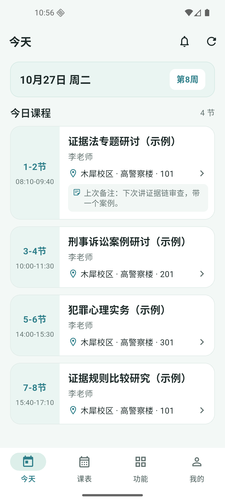 | 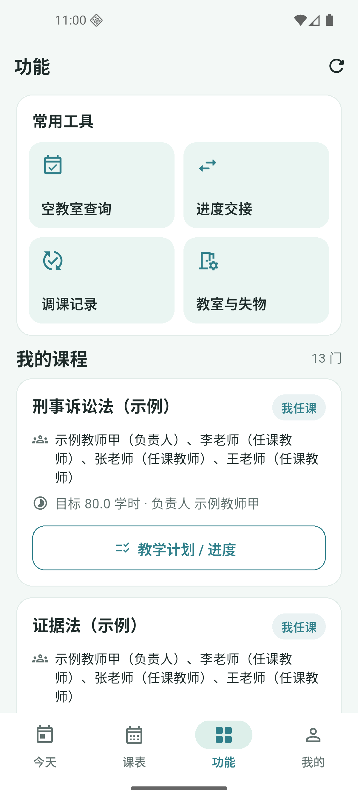 |

| 周一至周五的整周课表 | 清理技术用语后的备注 |
| --- | --- |
| 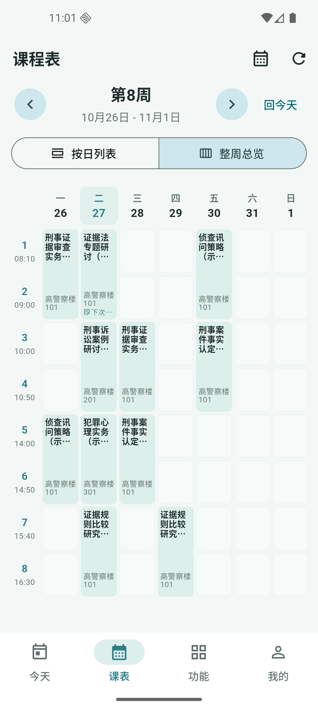 | 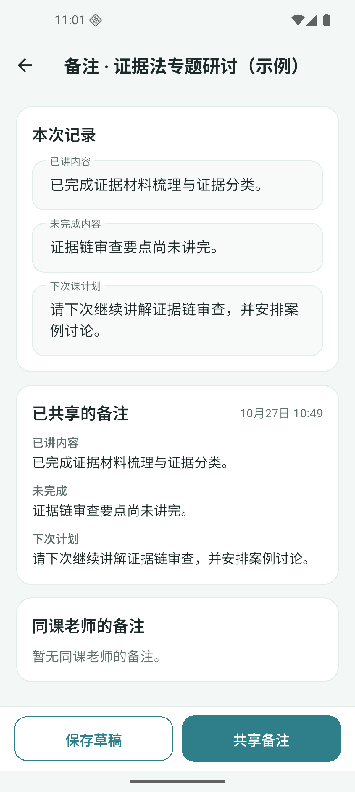 |

2026-10-28 按用户要求，将课程卡片摘要前缀由“上次备注”简化为“备注”；内容来源、两行上限、图标与排版保持不变。相关 3 项 widget 测试及静态检查通过。

## 首次登录课表导入演示追加验收

2026-10-28 按用户要求增加首次登录的课表导入画面。DeepSeek Harness 实现，Codex 审查、构建并在 Android 模拟器实测；沿用现有认证、bootstrap 接口和本地设置组件，无新增依赖或后端改动。

- 首次登录或恢复登录且当前学期没有完成记录时，显示教师姓名、工号与“匹配教师信息 / 获取本学期课表 / 整理课程安排”。成功后停留在结果页，点击“进入课表”记录完成；同账号、连接地址、学期再次进入跳过导入。失败可重试或返回登录，不伪造完成、不清除正常登录材料。
- 真实本地接口核对李老师为 **7 门课程、220 个本人非取消课次**，张老师与王老师均为 **7 门、190 个课次**。统计排除同课可见的其他教师课次。数据仍来自本机已导入的虚构模板和种子数据，没有连接学校官网，也不在登录时重新生成或覆盖课程、备注、交接。
- 实装确认李老师工号 0011 的首次结果、点击进入今日课表、强制重启后直接进入；退出后切王老师，出现工号 0013 的独立首次导入结果并可进入。登录页展开“其他演示账号”勾选“演示首次导入”，李老师可再次显示完整流程；当前模拟器留在李老师导入完成页，便于体验。
- Flutter 全量 **32 项测试通过**、全项目 analyze 无问题，11 个变更 Dart 文件格式检查通过。新增流程测试覆盖失败重试、进入前不写完成记录、本人非取消课次统计和同账号退出重登跳过。测试中的退出异步等待问题已修复，无需改变业务实现。
- Android ARM64/x64 release 构建、覆盖安装成功，APK 为 **44,285,539 字节**。本轮没有重新运行后端全量测试；已有后端记录仍作为历史验收保留。

操作与数据来源见[首次登录导入演示](demo-login-import.md)。当前只保存轻量完成记录，不代表已实现完整离线课表缓存。

| 首次获取课表 | 导入完成后进入课表 |
| --- | --- |
| 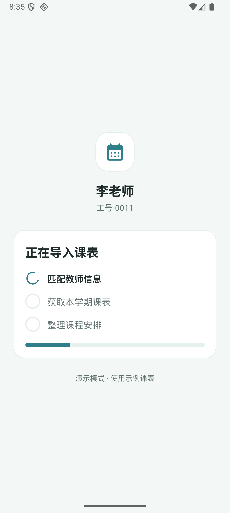 | 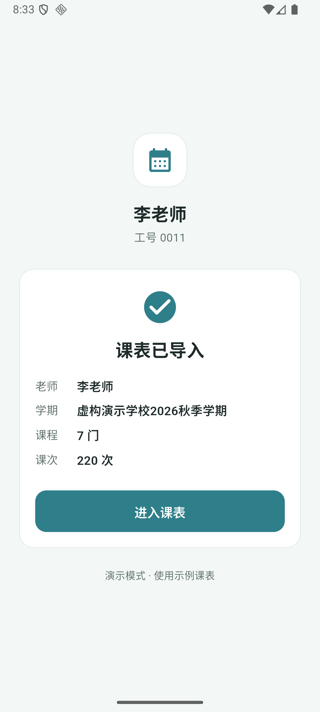 |

## 个人资料、修改密码与字号追加验收

2026-10-28 在首次导入版本基础上，DeepSeek Harness 实现三个基础功能，Codex 完成代码审查、Android 构建与模拟器操作验收。全部复用既有账号、资料和偏好接口，无后端改动、新依赖或数据库迁移。

- “我的 → 编辑资料”可修改显示名、院系、电话、微信，分别选择联系方式可见范围；工号、正式姓名和邮箱只读。实际将王老师显示名改为 `WangDemo`、填写虚构电话并选择同课程教师可见，保存后真实接口返回新值，今日课程卡片立即显示新称呼。验收后恢复王老师原资料。
- “我的 → 修改密码”支持当前密码、新密码、确认密码与显隐。实际使用教师甲：错误旧密码显示提示且保留输入；正确修改后回到登录页，显示“密码已修改，请重新登录”，旧表单消失。接口确认旧密码不可登录、新密码可登录，再恢复原演示密码并验证可用，李、张、王快捷密码保持不变。
- “我的 → 字号设置”提供跟随系统、大、更大。实装王老师选择“更大”后全 App 即时生效，重启继续保留，接口保存值为 `extra_large`；切到李老师显示其原有系统字号，没有串用王老师设置。王老师测试设置已恢复。偏好只更新 `font_size`，不改提醒或推送字段；读取失败不阻塞查课。
- 审查发现并交回 DS 修复字号旧请求覆盖新保存、换号时在途保存回写、改密请求中返回导致清登录遗漏及成功提示消失、显示名修改后周缓存仍旧等实际问题。没有引入额外基础设施。
- Flutter 全项目 analyze 无问题，格式检查无变更，全部 **39 项测试通过**（原 32 项与新增 7 项）。新增测试覆盖资料失败保留输入与保存回显、密码不一致不发请求、失败保留登录、成功重登及请求中返回、真实换账号、字号请求乱序与失败重试。
- Android ARM64/x64 release 最终构建成功并覆盖安装，APK **44,416,611 字节**。本轮不把既有后端历史测试当作重新运行；真实本地接口和实装操作结果如上。当前模拟器使用李老师，停在“我的”页，直接进入三个入口即可体验。

使用说明见[个人资料、密码与字号](demo-personal-settings.md)。

| 编辑资料与联系方式 | 全 App 字号预览 |
| --- | --- |
| 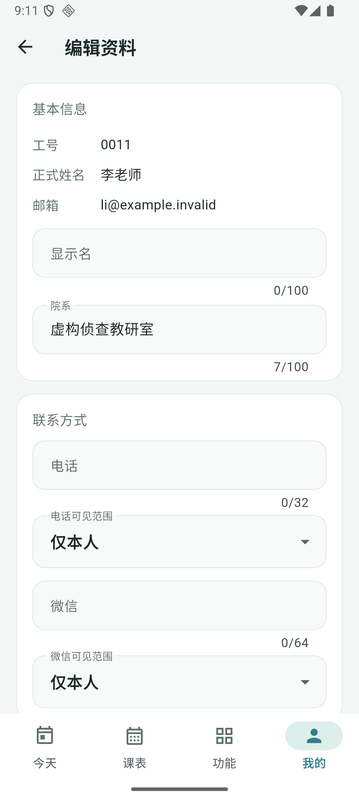 | 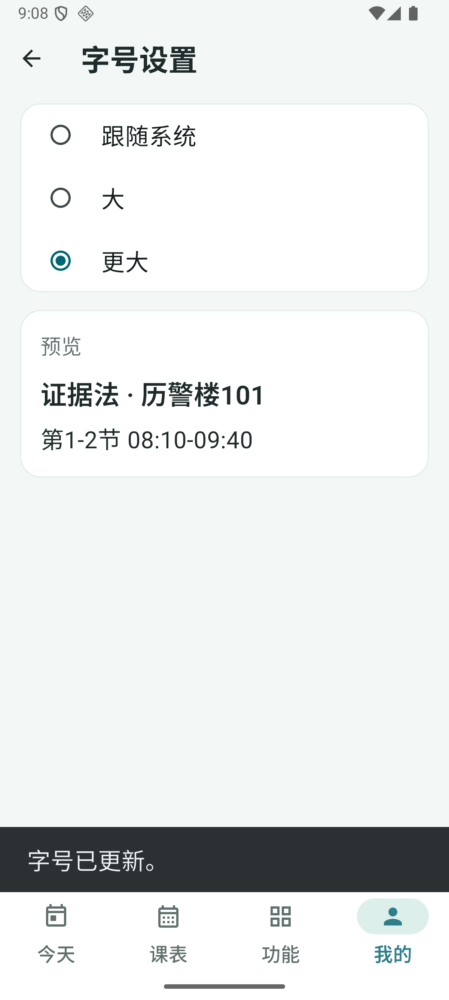 |

| 我的设置入口 | 修改密码 |
| --- | --- |
| 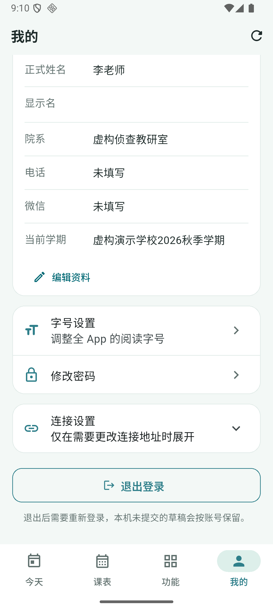 | 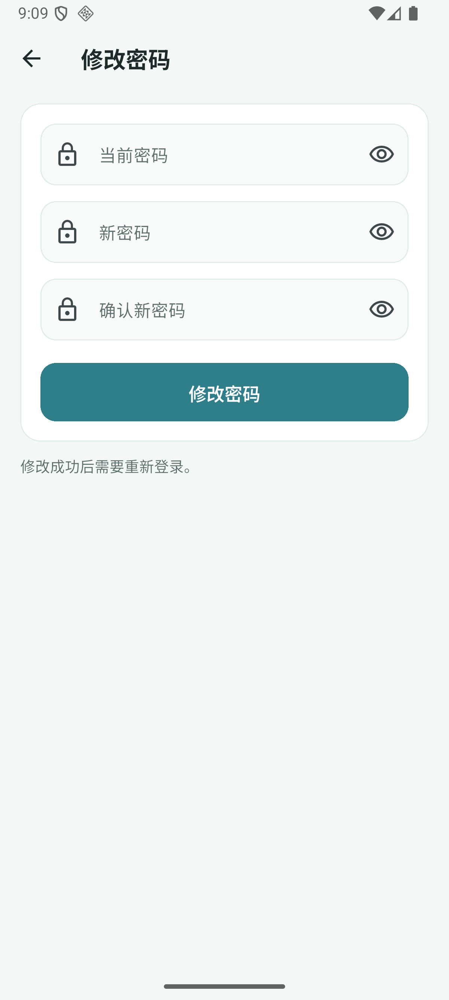 |

## 查询按钮、滚动效果与教师甲备注追加验收

2026-10-28 根据用户录屏反馈，由 DeepSeek Harness 实现，Codex 审查、构建和实装验收。

- 空教室底部操作栏与按钮铺满可用宽度，保留左右 16、上下 10 的间距，固定在列表下方、主导航上方；查询与加载状态沿用。实装按钮从原 `[381,2202][819,2358]` 调整为 `[48,2196][1152,2352]`（1200 像素屏宽），白底不再收缩成中间一小块。
- 复用 Flutter `MaterialScrollBehavior.copyWith(overscroll: false)` 全局关闭边缘拉伸装饰，保留列表滚动、惯性与下拉刷新。实际将空教室 26 条结果滑到底，在继续拖动期间截图确认文字、卡片与底部按钮保持正常形状；新增回归检查下拉刷新仍重新发起查询。
- 新增 `scripts/seed_demo_note_previews.py`，通过现有备注 API 给教师甲两门今日课程的上一课次补简短草稿。网络安全卡片显示“继续上次案例讨论，补充两道练习。”，电子数据取证显示“下次带一个真实案例，安排分组讨论。”；真实接口与实装“今天”卡片一致，前缀为“备注”，最多两行。
- 脚本首次执行新增 2 条，第二次新增 0；原有 3 条备注逐字段保留。1440 个课次的 ID、时间、状态、实际学时和版本摘要一致，计划与交接数量保持不变。只补空备注，不共享、不登记学时、不更改课次。
- 全项目 analyze 无问题、Dart 格式检查无变更，Flutter **41 项测试全部通过**，包含窄/宽屏按钮满宽、关闭拉伸并保留下拉刷新。新增脚本 Ruff 格式与检查通过，无新增依赖、迁移或后端业务改动。
- Android ARM64/x64 release 构建并覆盖安装成功，APK **44,416,611 字节**。当前模拟器停在教师甲今日课程，两条备注可以直接展示。

| 满宽的空教室查询按钮 | 教师甲卡片直接展示备注 |
| --- | --- |
| 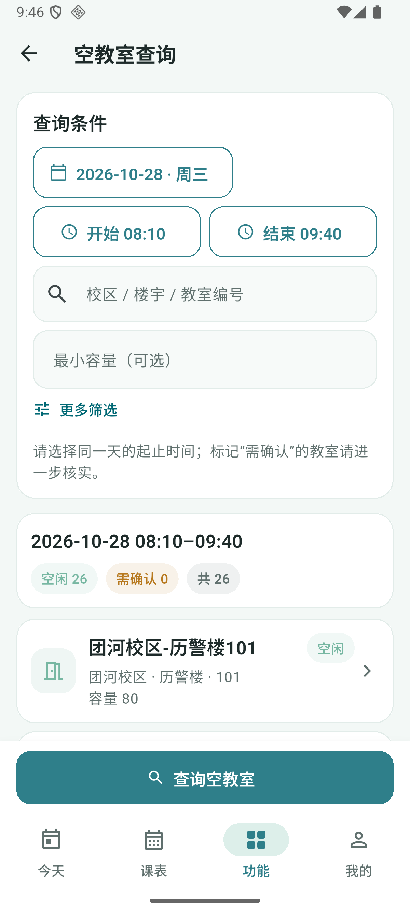 | 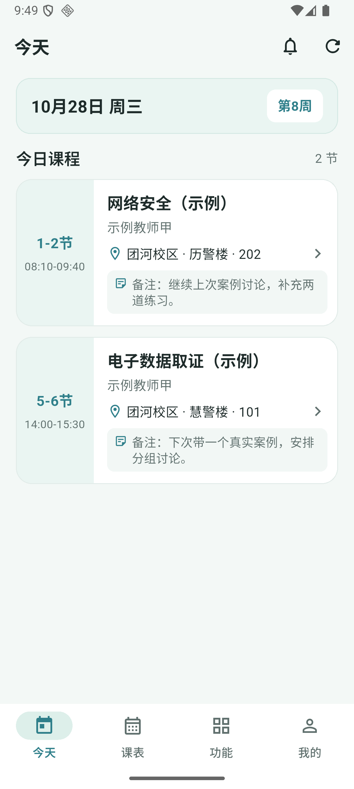 |

## AI 课前备课助手追加验收

2026-10-28 按用户要求增加真实 AI 教学辅助功能，由 DeepSeek Harness 实现，Codex 审查、配置本地服务、构建并实装验收。复用现有依赖，没有新增 SDK、缓存或队列。

- 本人课次详情新增满宽“AI备课”入口。页面带出课程、日期节次、实际授课分钟数、上一短备注及已有教学计划，按本节主题生成“授课提纲 / 课堂案例 / 讨论问题 / 课前准备”，四段均可编辑和保存；再次打开读取本人该课次的备课。
- 真实接口验收：本机后端调用配置的兼容服务及 `deepseek-v4.1-flash`，为教师甲“网络安全”生成四段共 452 字，约 9.4 秒；提纲合计 80 分钟，承接上一备注中的案例和练习。确认生成未落库，再修改课前准备、保存和重读，四段与输入一致。
- Android 实装验收：教师甲打开 10/28“电子数据取证”，实际点击生成得到四段中文内容（15 + 40 + 25 分钟）；课堂案例明确为虚构。编辑课前准备加入 `PPT`，点击保存后显示“备课已保存”，返回详情再打开，四段及编辑内容仍在。后端确认两份独立备课均已保存，版本为 1。
- 生成和保存期间输入框只读、操作按钮禁用，完成后恢复。重新生成先确认替换；失败保留输入，保存失败在当前视口提示。内部模型名、对象编号和版本号不展示给教师。
- 生成与保存后，将 1440 个课次、5 条备注、2 条交接和 1 份教学计划的全部字段摘要与改动前比较，均一致；没有改课表、登记学时或共享教学备注。备课数据单独保存。
- 后端 teaching 回归 **67 项通过**；增加真实应用请求标识后，备课 **8 项再次通过**。Ruff 格式/检查、Django check、迁移差异及 OpenAPI 零警告校验通过；本地服务已执行 `0004_lessonpreparation` 迁移。
- Flutter 全量 **60 项通过**（此前 41 项 + 新增 19 项），包括接口合同、55 秒局部超时、生成编辑保存重开、重新生成确认、失败保留输入及 390×844 小屏底部错误可见性。最终格式检查 84 文件无变更、全项目 analyze 无问题；默认解释性说明删除后再次通过格式和 analyze。
- Android ARM64/x64 release 构建成功并覆盖安装，APK **44,416,611 字节**。DockerHub 构建前端元数据请求因网络 EOF 未完成；本次本地服务沿用已有锁定依赖运行镜像，仅复制更新后端源码进行增量构建，再重建 API 容器，健康检查、迁移及真实 API 流程均通过，没有把完整联网镜像构建表述为成功。

使用与配置见 [AI 课前备课助手](ai-lesson-preparation.md)。模型生成需要电脑能够访问所配置 API；课表服务和数据仍在本机，未配置模型时可继续查看课表、手写并保存备课。

| 课程上下文与主题 | 真实生成的提纲与案例 | 编辑保存后重新打开 |
| --- | --- | --- |
| 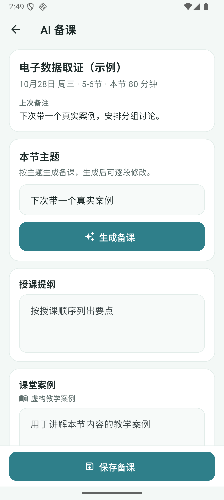 | 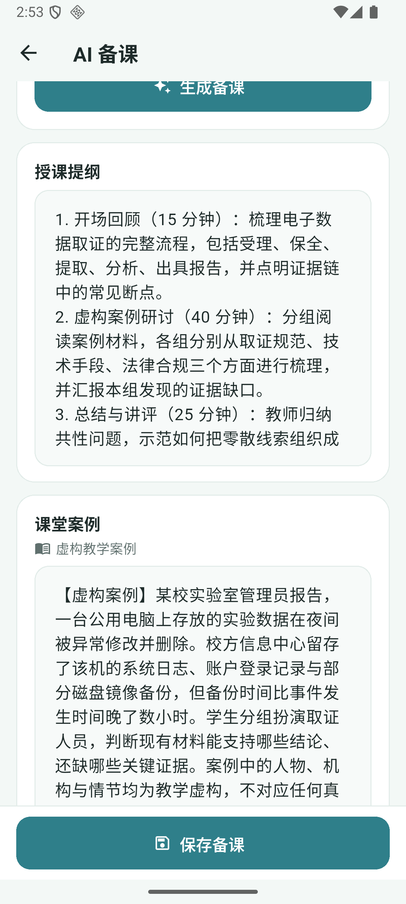 | 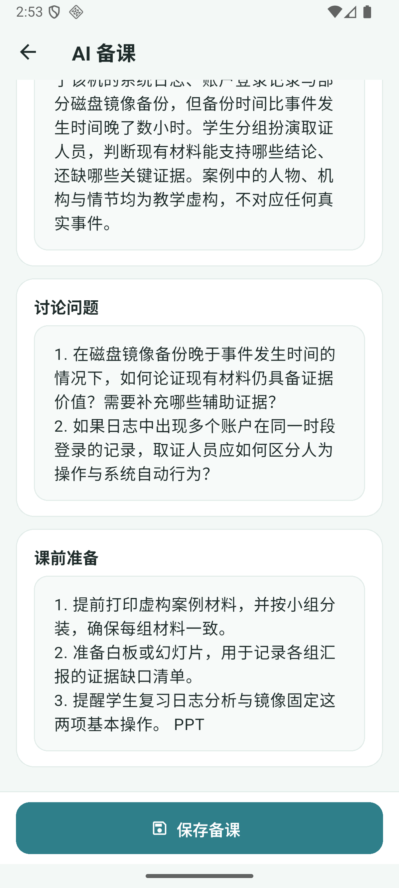 |

## 教学进度与活动数据追加验收

2026-10-28 按用户要求适量补齐各页面业务数据。DeepSeek Harness 实现独立种子 `scripts/seed_demo_activity.py`，Codex 审查后在现有本地容器执行，并核对真实接口与 Android 页面。本轮不改 App 代码、接口或统计规则，不需重装 APK。

- 首次新增 36 份计划、144 个专题，保留原有计划与专题，共 37 份计划、146 个专题。新增专题按课程名称分为基础、案例、研讨和复习阶段，预计学时合计等于课程目标，并设阶段截止日期。
- 通过既有完成登记服务，新增 386 个历史课次完成记录和对应专题学时；全部在 10/28 之前，按稳定的历史课次子集登记约 75%，保留其余待确认。专题按顺序分配，少量学时留待归入专题；原有已完成记录保留。今天及未来课次的全部字段保持一致。
- 新增 4 条简短备注、4 条交接、3 条待审批调课申请、4 条失物询问与 2 条回复。教师甲、李、张、王的交接和失物均有双向内容，各有 1 条调课记录和可见站内消息。申请不更改正式课表，交接保留待确认、失物保留待回复样例。
- 第二次运行各类新增均为 **0**；将 17 张业务表的完整快照与首次执行后逐字段比较，完全一致，未重复计学时或发消息。1440 个课次、76 条排课规则、837 条既有正式变更和 2 份真实 AI 备课保留；原有备注、计划、交接、申请、失物与完成记录逐字段不变。
- 四个账号通过真实登录与接口检查：所有本人课程都有计划、已完成学时大于 0、有非零专题进度及剩余课程；教师甲各课程已完成 14–22 学时，李、张、王各课程为 20–22 学时。交接、失物两向列表均有记录，调课列表与站内消息可读。
- Android 原截图页面刷新后实际显示“进度正常”：网络安全已完成 **22.0 / 80.0**、剩余 **58.0**、剩余课次 **29**、过去待确认 **5**、未归入专题 **1.0**，下方显示 4 个阶段专题。未来专题的实际学时与超额学时等正常零值保留。

本轮沿用既有依赖和业务服务；最终脚本与容器副本哈希一致，复跑各类新增为 0。按后端 Ruff 配置的静态检查与格式检查通过，启动脚本的 PowerShell 语法检查无错误，文档链接检查通过。验证重点为数据关系、原记录保留、重复运行和真实页面，没有重跑未修改的 Flutter 或整个后端测试套件。使用说明见[活动演示数据](demo-activity-data.md)。

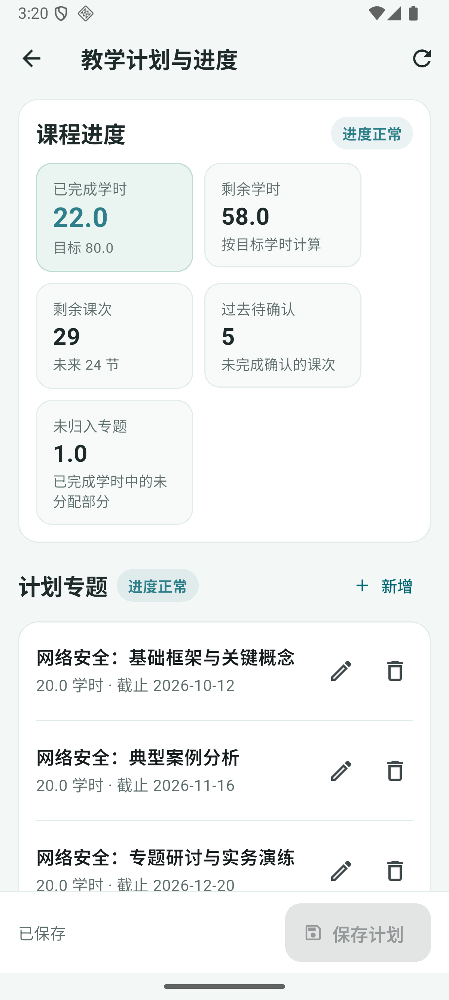

## 教师甲首次导入录屏调整

2026-10-28 根据录屏反馈，由 DeepSeek Harness 调整首次导入演示节奏，Codex 完成审查、测试和 Android 构建验收。

- 教师甲（工号 0001）三段导入动画各约 883 毫秒，总展示时间约 2.65 秒，比原节奏增加约 1 秒，便于看清“匹配教师信息 / 获取本学期课表 / 整理课程安排”。
- 李、张、王及其他账号仍使用原来的每段 550 毫秒；课表 bootstrap 请求继续与动画并行，失败重试和已有导入记录的跳过逻辑不变。
- 修改范围仅为移动端首次导入控制器和页面传参；Flutter 格式检查、`flutter analyze` 与 `flutter test test/widget_test.dart` 均通过。Android 安装包重新构建并覆盖安装后，再进行教师甲首次导入演示。

操作步骤见[首次登录课表导入演示](demo-login-import.md)。

## 当前边界

这是可本地操作的演示版。登录页主要提供李、张、王三位教师快捷填入，甲、乙保留在折叠区；资料与联系方式编辑、改密和字号可用，完整注册/找回密码、头像编辑的移动 UI 尚未补齐，相关后端接口已保留。完整冷启动离线课表和系统课程提醒尚未实现。教学计划、完成登记、交接与失物询问需要本地服务在线。交接列表目前读取前 50 条，足够当前演示数据。

未做真机性能基准或 iOS 构建验收，不以模拟器操作结果保证所有手机性能。远程推送、云部署、商店发布、复杂 snapshot 导入继续留作后续工作，不阻塞本地演示。

## 实际截图

| 周课表 | 常用功能 |
| --- | --- |
|  |  |

| 教学计划 | 调课底部提交区 |
| --- | --- |
|  |  |
