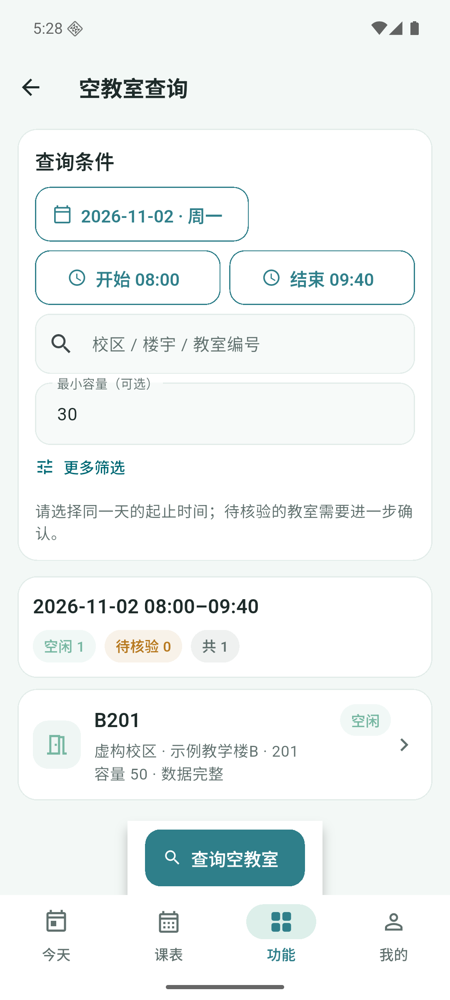
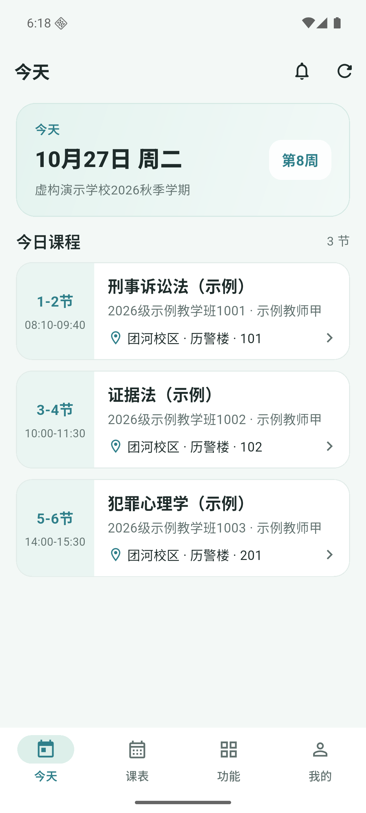
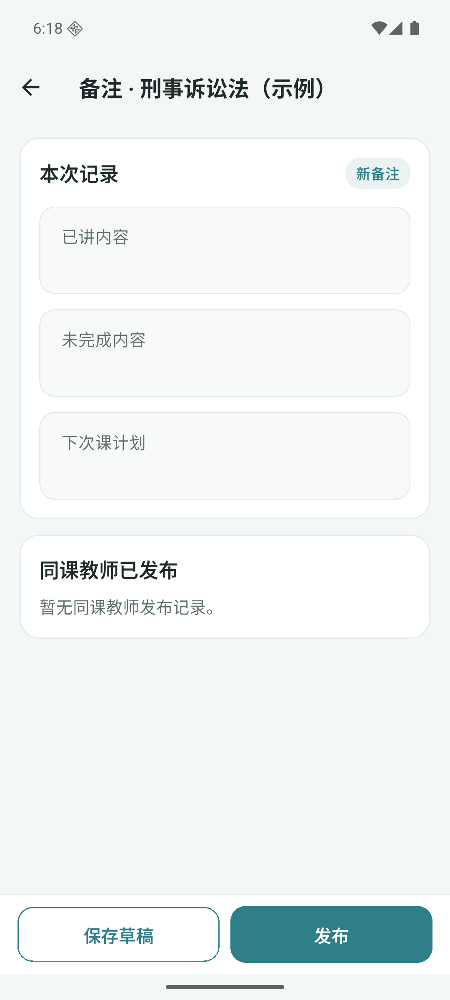
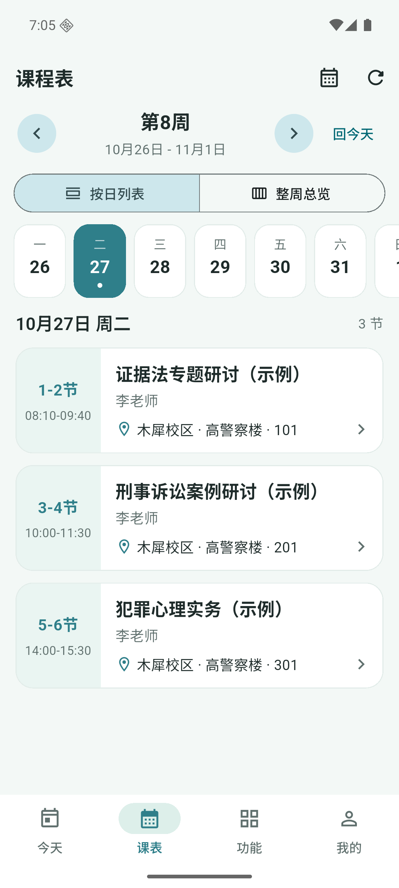
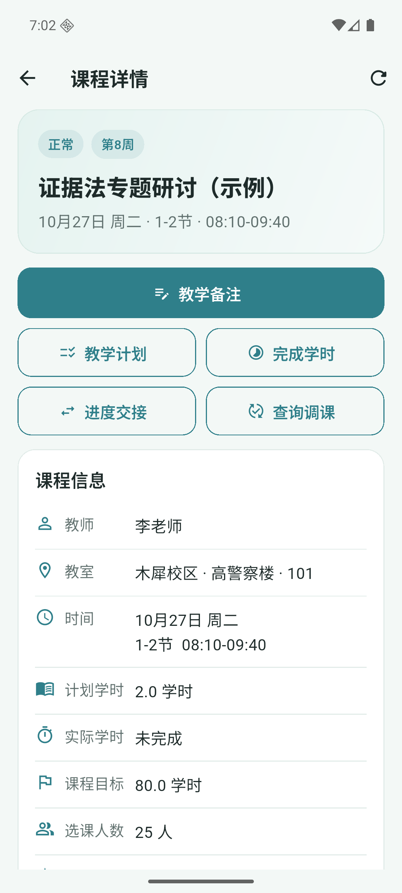
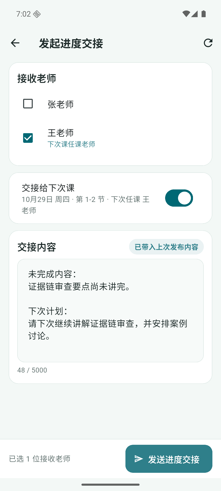
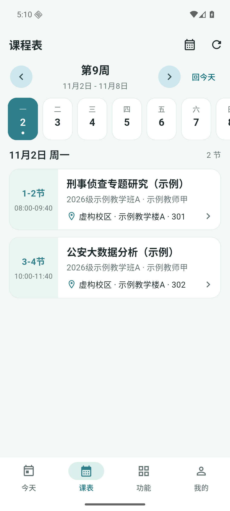
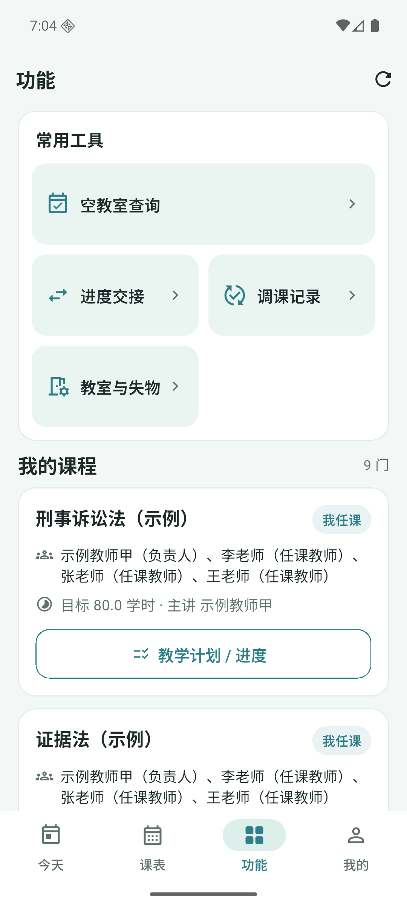
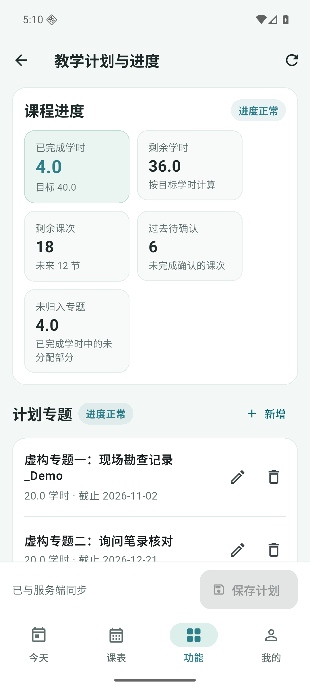
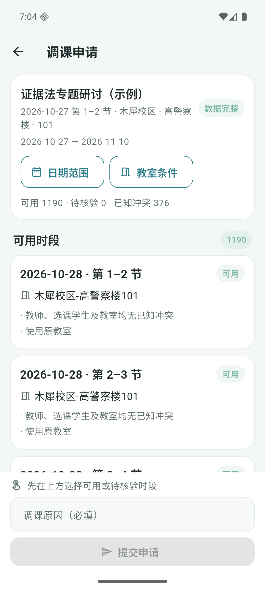

# 本地演示验收记录

日期：2026-10-27。范围：本机 Django/PostgreSQL 服务和 Android 安装包，全部使用虚构数据。功能实现及修复由 DeepSeek Harness 完成，Codex 负责派工、审查、构建与实际操作验收。

## 交付物

- Android APK：`mobile/build/app/outputs/flutter-apk/app-release.apk`，当前版本 44,154,467 字节，含 ARM64 / x64，使用演示签名。
- 一键启动：仓库根目录执行 `pwsh scripts/start-demo.ps1`。
- 账号、日期与演示步骤：[本地演示说明](local-demo.md)。
- 公开仓库保存源代码，构建产物与本机 SDK 路径配置不入库。

## 实际操作结果

在 Android 36 模拟器上安装 release APK，连接本机 `teacher-schedule-demo` 服务进行验收。

| 流程 | 操作与实际结果 |
| --- | --- |
| 登录 | 两个虚构教师账号均可登录；重启 App 可恢复登录；可退出并切换账号 |
| 课表 | 今日无课提示、按周/按日查看、课程详情可用；11 月 2 日教师甲显示两门示例课程 |
| 备注 | 早期本地预览环境实际保存草稿再发布，后端确认文本与发布版本已更新；同一 JSON 合同有自动测试 |
| 交接 | 教师乙打开种子交接仅记录已读，明确点击确认后状态变为已确认，后台确认时间已保存 |
| 计划 | 教师甲编辑示例专题标题并保存，计划从 v1 更新为 v2，增加对应修订记录；进度显示 4.0 / 40.0 学时 |
| 学时 | 教师甲对 10 月 26 日大数据课确认 2.0 学时，页面显示已完成，后端写入完成记录 |
| 调课 | 对 11 月 2 日刑侦课查询得到 138 个可用、23 个冲突候选；选 5–6 节并填写原因，成功提交待审批申请；原课次时间与版本保持不变 |
| 教室历史 | A301 切到 10 月 26 日，显示 1–2 节刑侦课与示例教师乙 |
| 协查 | 教师乙追加“未见到”回复，教师甲看到回复并结案；后端分别保存 replied、closed 状态与结案说明 |
| 重复初始化 | 再运行种子脚本前后均为 40 课次、1 备注、1 计划、1 交接、1 协查；保留已操作数据 |

验收中修正了调课长列表的操作问题：原因输入与提交按钮固定在底部，无需滑过全部候选。普通教师界面中的版本参数、原始完成凭证等实现细节已隐藏。

## 检查结果

- Flutter 全部 21 项测试通过；增加空教室查询和界面调整后已再次运行并通过。
- Flutter 全项目 analyze 无问题；最后调课文件单独 analyze 亦通过。
- 最终 Android release 构建成功，并覆盖安装后实际提交调课申请。
- 后端全量默认测试首轮为 424 通过、1 失败、2 个性能用例按默认配置排除。唯一失败是 Admin 测试使用固定的当天下午时间，执行时已过期；仅在测试中固定时钟后单独复跑该用例通过，原断言保留。没有宣称修复后重新跑过全部 425 项。
- Django 系统检查、迁移差异检查、OpenAPI 校验、Ruff 检查通过。

## 空教室查询追加验收

同日新增“功能 → 空教室查询”。默认表单提供日期、起止时间、模糊搜索、最小容量；精确校区/楼宇折叠在“更多筛选”。结果按需构建并分页加载，查询按钮固定在底部，不新增依赖。

- 新后端教室查询及既有教室回归共 10 项通过，共享调课覆盖逻辑回归 17 项通过；Ruff、Django check、OpenAPI 校验通过。
- 真实 HTTP 接口 9 个场景通过：课程占用、容量、时间边界相接、另一门课占用、维修占用、无结果、楼宇筛选、校区搜索和覆盖缺失日期。
- 安装最终 APK 后实际选择 2026-11-02 08:00–09:40，得到 A302、B201；容量输入 30 并重新查询，仅显示 B201。
- 点击 B201，进入教室使用记录，日期保留为 2026-11-02；页面正确显示该日无排课。
- 已知占用排除；缺覆盖的候选标记“待核验”。按现有规则处理取消和正式调课后的当前教室，不将旧历史位置重复算作占用。

## 演示数据扩充验收

同日按用户要求增加课程，并使用指定校区和楼宇名。当前共 22 门课、22 个开课、10 位教师、30 间教室、503 名虚构学生、840 个课次。课程、学生、房号及安排均为演示生成。

- 校区只有团河校区、木犀校区；楼宇使用历警楼、慧警楼、高警察楼；30 间教室的房号均为三位数字。
- 新增脚本 `scripts/seed_demo_extra.py` 复用现有课次生成服务；原始 12 个导入模板保持不变。
- 首次执行新增 20 门课、8 位教师、27 间教室、500 名学生、800 个课次；再次执行这些新增数均为 0，保留 840 个课次。
- 将执行前的原 40 个课次以及备注、计划、交接、协查、调课申请逐条与执行后比较，所有原记录字段保持一致；仅按要求更改旧教室的展示地点。
- 对非取消课次按教师和教室检查时间重叠，无冲突；本周教师甲周一至周五分别有 2、3、2、3、3 次课，教师乙为 3、3、2、3、2 次课。
- 真实 API 确认教师甲本周 13 次课、今天 3 次课、可见开课 8 门；两个校区教室搜索分别为 16 和 14 间。周二 08:00–09:40 空教室查询返回 27 间空闲，排除 3 间已有课程的教室。
- 已刷新模拟器，“今天”实际显示刑事诉讼法、证据法、犯罪心理学，以及团河校区历警楼 101、102、201。

上述空教室追加验收的两间教室示例基于扩充前的 3 间教室数据；扩充后结果数量以当前筛选为准。此次只变更种子与演示数据，沿用同一 APK。

## 研究生节次与备注界面追加验收

- 上午 1–4 节为 08:10–08:50、09:00–09:40、10:00–10:40、10:50–11:30；下午 5–8 节为 14:00–14:40、14:50–15:30、15:40–16:20、16:30–17:10。逐节验证均为 40 分钟，上午中间 20 分钟休息，其他间隔 10 分钟。
- 837 个待上课课次经现有批量导入写入口同步钟点，保持课次 ID、日期、节次、教师、教室与学时数量；3 个已完成历史课次保持原记录。学期和全部 22 个开课的学时分钟数改为 40。
- 重复运行没有新课次、修正批次或重复通知；备注、计划、交接、协查与调课申请内容保留。已有待审批申请收到节次变更核对提示。
- 备注页删除顶部解释卡片和三个输入框的长提示，统一显示“已讲内容 / 未完成内容 / 下次课计划”；历史卡片中的“已覆盖”也同步替换。空备注发布提示简化为“请填写备注”，其他错误保留原信息。
- 空教室查询默认开始时间同步为 08:10，仍可自由选择时段。
- 最新移动端 21 项测试通过、相关 analyze 通过，release APK 构建与覆盖安装成功；实际页面显示 08:10–09:40、10:00–11:30、14:00–15:30，备注页说明卡片和长提示已移除。

## 三教师协作与界面调整追加验收

同日按用户截图完成移动端调整，DeepSeek Harness 实现，Codex 审查、运行检查、构建并覆盖安装新版。当前数据为 25 门课程、25 个开课、13 位教师、30 间教室、578 名虚构学生、960 个课次。

- 登录页新增李老师、张老师、王老师快捷填入；三人均通过真实 API 登录。李老师为 3 门轮讲课的负责人，周二上课，周四由张/王按单双周接课。三人也加入原有 6 门示例课的任课范围，原实际授课安排保持不变。
- 三教师种子首次新增 120 个课次、75 名学生；重复执行新增数均为 0，规则及教室稳定。执行前的 840 个课次及已有备注、计划、交接、询问、调课记录逐条比对保留。
- 实装页面确认：课程详情不再显示班号、开课编码；调课页显示真实课程名称、原日期节次与地点，不显示课次 UUID；今天使用简洁课程卡片。
- “发交接”统一改为“进度交接”；选择接收老师后可关联“交接给下次课”，直接显示下一次日期、节次与任课老师。已实际用李老师在 App 勾选王老师并发送成功，后台确认接收人为王老师、状态待确认、目标课次为 2026-10-29 1–2 节，留作切换账号演示；不把已读当作确认。
- 课表支持“按日列表 / 整周总览”，复用已取回周数据；整周按实际校历显示 7 天、8 节，跨两节课程完整占据两行，教室楼宇及房号换行显示。自动测试覆盖切换不重复请求，以及点击跨节课程下半部分进入详情。
- “教室历史”“协查收发”合并为“教室与失物”，内部为“教室记录 / 失物消息”；实装打开统一入口确认教室目录可用。导航测试验证查询历史日期后发起询问保留日期、发送后回到“我发起的”并刷新列表，旧空教室结果仍保留查询日期。底层接口与旧消息跳转沿用。
- 最新 Flutter 全部 **25 项测试通过**，全项目 analyze 无问题，21 个本轮 Dart 文件格式检查通过；Android release 构建成功并覆盖安装。本轮未修改后端业务接口，不将此前后端全量结果冒充重新运行。

| 精简后的课程详情 | 进度交接接收人与下一次课 |
| --- | --- |
|  |  |

## 当前边界

这是可本地操作的演示版。登录页主要提供李、张、王三位教师快捷填入，甲、乙保留在折叠区；完整注册/找回密码、头像编辑的移动 UI 尚未补齐，相关后端接口已保留。教学计划、完成登记、交接与失物询问需要本地服务在线。交接列表目前读取前 50 条，足够当前演示数据。

未做真机性能基准或 iOS 构建验收，不以模拟器操作结果保证所有手机性能。远程推送、云部署、商店发布、复杂 snapshot 导入继续留作后续工作，不阻塞本地演示。

## 实际截图

| 周课表 | 常用功能 |
| --- | --- |
|  |  |

| 教学计划 | 调课底部提交区 |
| --- | --- |
|  |  |
