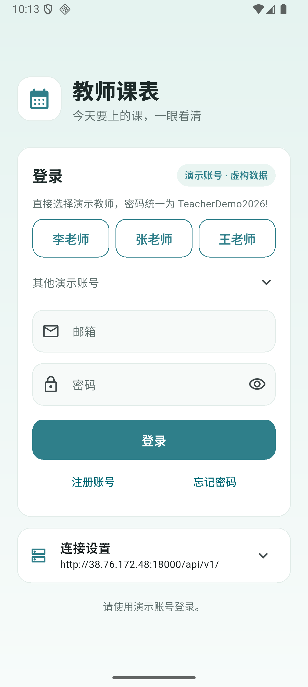
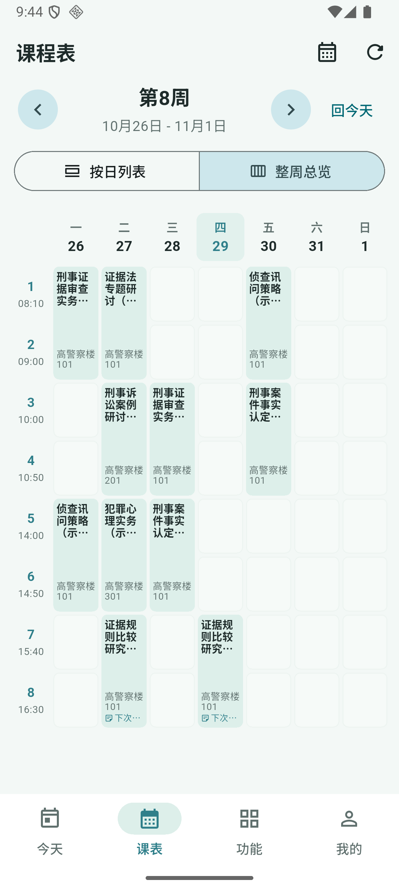
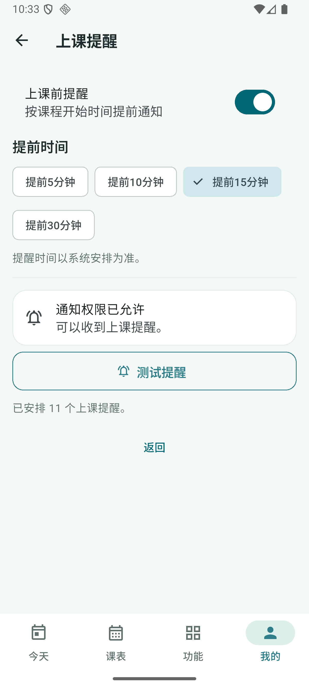

# 手机联网演示

本轮目标是 Android 手机安装后直接联网演示。沿用现有 Django/PostgreSQL 和虚构账号，不接学校官网、SSO 或教务接口；手机无需与电脑处于同一 Wi‑Fi。当前部署与验收进度见本文件末尾，不把待验证项目视为交付。

## 运行方式

- 后端已按用户要求从香港完整迁往北京服务器，目录 `/srv/teacher-schedule`，独立 Compose 项目 `teacher-schedule-phone`；[迁移范围及核对](beijing-migration.md)。
- 当前服务地址为 `http://101.201.48.132/api/v1/`，直接使用 IP，不配置域名，公网入口为 TCP 80。
- 数据库和媒体使用独立持久卷，香港原应用与数据库停止，保留备份及原卷；旧 API 地址转发到北京，原服务器其他应用保留。
- APK 用 `API_BASE_URL` 构建配置指定默认服务地址，仍保留手动连接设置。当前北京新包会自动更新已保存的旧香港地址并复制字号/导入记录，保留登录和草稿；其他自定义地址保持手动设置。

手机需要能够访问服务器。普通课表、备注、学时、交接和失物数据保存在服务器；模型生成由后端调用已配置服务，手机端不保存模型 API 密钥。

2026-10-30 内置 AI 备课已切换到 Yue 的 `deepseek-v4.1-flash`，并随应用迁到北京。北京公网真实生成用时 7.4 秒、四段共 511 字，生成前后草稿不变；香港的 7.7 秒 / 405 字为此前验收。配置与验收见[AI 备课说明](ai-lesson-preparation.md)。

## 手机安装

安卓手机下载 [GitHub Release 的蓝白预览版安装包](https://github.com/xuanfengdabiti/teacher-schedule-app/releases/download/v1.2.0-preview.4/teacher-schedule-v1.2.0-preview.4-android.apk) 后安装；[发布页](https://github.com/xuanfengdabiti/teacher-schedule-app/releases/tag/v1.2.0-preview.4)提供安装说明和 `SHA256SUMS.txt`，公开下载无需登录。当前版本为 **1.2.0（6）**、**46,225,831 字节**，直连北京，可覆盖安装保留原登录、导入与字号记录。原版 [1.1.0](https://github.com/xuanfengdabiti/teacher-schedule-app/releases/tag/v1.1.0) 和此前预览版的发布资产保留。

[北京服务器备用下载](http://101.201.48.132/teacher-schedule.apk)使用 80 端口，由 Nginx 提供文件；APK 与本机构建摘要一致，HTTP 200、分段下载 206、长度与文件头校验通过。香港旧下载地址由原 `teacher-schedule-download.service` 返回 302 到北京；旧 API 端口也由该服务转发。

当前 APK SHA-256：`6EA250649E02C17536CEC59A86FCA48B53FD15E16C41DDF0D8AF303F725D6A2F`。

首次安装已预设服务器地址，直接选择演示账号并登录。建议主讲演示使用“其他演示账号”里的教师甲（`t0001@example.invalid`）；李、张、王可用于交接与失物回复。统一密码 `TeacherDemo2026!`。首次进入会展示导入画面，同账号、地址、学期已有完成记录后跳过，也可勾选“演示首次导入”重放。

## 补齐的手机能力

本轮由 DeepSeek Harness 实现，Codex 负责审查与运行验收：

1. 注册账号、验证邮箱、重发验证、请求重置与确认重置的手机页面，复用已有认证接口。
2. 从系统相册选头像、预览、上传、鉴权读取及移除。
3. Android 上课本地提醒设置、提前时间、系统通知权限与测试提醒；按本人未来课程安排更新提醒。
4. 可预配置公网地址的安装包，避免新安装默认连接模拟器专用地址。

邮箱流程支持粘贴验证或重置链接。当前未提供真实 SMTP，演示服务器沿用 console 邮件后端；手机页面与接口闭环验收和真实邮箱送达是两件不同的事，不声称已接通真实发信服务。现有李、张、王和教师甲账号可直接登录。

## 新增依赖与复用依据

本轮先核查现有包，未重复实现相册选择或系统通知：

| 依赖 | 许可与来源 | 用途与适配 |
| --- | --- | --- |
| image_picker 1.2.4 | [Flutter 官方包](https://pub.dev/packages/image_picker)，BSD-3-Clause / Apache-2.0 | 复用系统相册和图片尺寸/质量选项；头像继续走已有 multipart 接口 |
| flutter_local_notifications 22.3.3 | [维护方文档](https://pub.dev/packages/flutter_local_notifications)，BSD-3-Clause | 复用 Android 通知与定时通知；不另写通知 SDK |
| timezone 0.11.2 | [Dart 官方发布者文档](https://pub.dev/packages/timezone)，BSD-3-Clause | 按课次实际时间和学校时区计算提醒时间 |

依赖锁定在 `mobile/pubspec.lock`；既有 Flutter/Riverpod/Dio/SharedPreferences 继续复用。提醒使用系统允许的非精确调度，手机系统可能延后通知；不申请精确闹钟或增加后台常驻服务。

## 构建与服务器操作

```powershell
cd mobile
flutter build apk --release --build-name=1.2.0 --build-number=6 --target-platform=android-arm64,android-x64 --dart-define=API_BASE_URL=http://101.201.48.132/api/v1/
```

本机 Windows 曾遇到 Kotlin 跨盘增量缓存错误。Flutter 步骤生成 SDK、版本等本地配置后，以下方式已实际构建成功（本机沿用现有 JDK 21、Android SDK 与临时目录配置）：

```powershell
cd android
$taskDefine = [Convert]::ToBase64String([Text.Encoding]::UTF8.GetBytes('API_BASE_URL=http://101.201.48.132/api/v1/'))
.\gradlew.bat assembleRelease '-Pkotlin.incremental=false' '-Ptarget-platform=android-arm64,android-x64' "-Pdart-defines=$taskDefine"
```

通知小图标通过 `android/app/src/main/res/raw/keep.xml` 保留单个 `@drawable/ic_notification`，避免 release 压缩后测试通知与课程提醒无法显示。

服务器复用 `infra/deploy/compose.yaml` 与 `backend/Dockerfile`。私有部署配置保存在服务器 `infra/deploy/.env`，不提交仓库。当前服务器 Docker Hub 直连超时，构建时使用相同 Python/PostgreSQL 镜像的镜像源，不更改项目依赖锁定。

```sh
cd /srv/teacher-schedule
docker compose -p teacher-schedule-phone --env-file infra/deploy/.env -f infra/deploy/compose.yaml ps
curl -fsS http://127.0.0.1:18000/api/v1/health/
```

首次在香港部署时，本机 Docker 异常，未导出旧电脑数据库，因此当时通过种子建立虚构数据，旧电脑数据另行保留。该限制属于 10月29日首次部署；10月30日香港到北京已整体迁移香港现有数据库与附件，包括其人工操作和 AI 草稿，没有重新造数据。两次迁移范围须区分。

## 实际验收进度

2026-10-30 北京迁移：62 张表、8,492 条记录、19 个序列和 12 个媒体文件内容核对一致；原登录材料、四账号主要功能读取及真实 AI 生成通过。Flutter **140 项测试通过**、静态检查通过、115 个 Dart 文件格式检查无变化。Android **1.2.0（6）** 在模拟器实际覆盖安装，自动连接北京，4 条字号/导入记录迁移正确，教师甲直接进入已有课表，短备注与课程操作菜单正常；北京访问日志确认收到手机 App 请求。详情、摘要与截图见[北京迁移](beijing-migration.md)。下面保留首次香港部署的历史记录。

2026-10-29：服务器已启动 API 与 PostgreSQL，外网访问健康检查返回 `status=ok, database=ok`。虚构数据已初始化：37 门课程、30 间教室、1,440 个课次；教师甲及李、张、王均已通过外网登录和本人周课表、开课、教室、偏好读取验收。注册、验证、请求重置、实际链接确认重置、新密码登录通过后端测试，邮件由测试捕获而非真实送达。头像通过公网实际上传、鉴权读取、资料刷新、删除验收，结束后恢复教师甲原无头像状态。保留 2 份历史 AI 备课；公网真实生成接口另一次调用成功，用时 8.6 秒，四段共 440 字，未保存或修改课程数据。

最终 Flutter 全量 **117 项通过**，全项目 `flutter analyze --no-pub` 无问题，108 个 Dart 文件格式检查无变化。Android ARM64 / x64 release **1.1.0（2）** 构建成功并覆盖安装，最低 Android 7.0（API 24）；APK 为 **46,029,223 字节**，构建前后全部 Dart 源码摘要一致。没有连接实体手机，以上安装记录属于 Android 模拟器验收。

APK SHA-256：`6F71A97D51C4211EA3BFDACA9122C2116F5E3B445BD253A9A98B75B6DFFFACEE`。

### Android 安装后的实际操作

| 检查 | 已观察到的结果 |
| --- | --- |
| 公网登录与首次导入 | 李老师完成首次导入，7 门本人课程、220 个课次；本人今日课表和整周课表读取正常，简短备注直接显示 |
| 头像 | 系统相册选择测试图片→预览→上传成功→页面回显→移除成功；结束后恢复原姓名首字 |
| 提醒权限与系统显示 | Android 通知授权通过，点击“测试提醒”后系统通知栏实际出现对应标题与正文；release 保留小图标资源，避免压缩后丢失 |
| 课程提醒安排 | 李老师未来课程产生 11 个系统待触发提醒；08:10 上课的提醒设置为 07:55，改提前 10 分钟后为 08:00，随后恢复 15 分钟 |
| 关闭与退出 | 关闭提醒后系统待触发数变为 0；再次开启恢复 11 个，退出登录后系统待触发数再次从 11 变为 0 |
| 其他演示账号 | 教师甲完成 8 门本人课程、270 个课次的首次导入；冷启动恢复账号后系统安排 14 个未来课程提醒 |
| 最终包换账号 | 正常退出李老师并完成清理后登录教师甲，提醒页结束加载、控件可用、系统安排 14 个提醒；已移除控制器内重复监听账号造成的状态重置 |

以上系统结果来自 Android 36 模拟器实际安装的 release 包。尚未等待未来课次的真实触发时刻，非精确提醒的实际送达受手机系统调度影响。演示设备时区从 GMT 调整为 `Asia/Shanghai` 后重启 App，确认显示 08:10–11:30 / 14:00–17:10 的学校时段。

| 登录入口 | 整周课表 |
| --- | --- |
|  |  |


